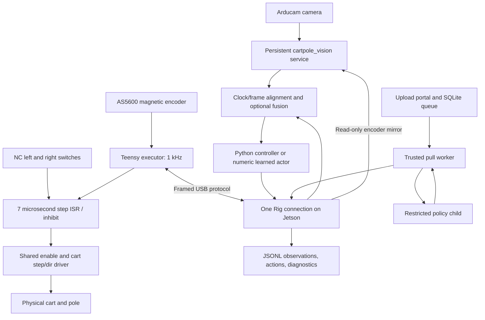

# Cartpole v2 — system, mathematics, operating guide, and development history

**Audit date: October 23, 2026 (America/Detroit).** This is a consolidated account of the “Plan Cartpole software v2” chat, the local working tree, its recorded experiments, and read-only inspection of the Jetson deployments. It describes the system we built, including unsuccessful experiments and remaining gaps. It does not promote a policy or calibration merely because its implementation exists.

The source baseline at the start of this audit was `cbd833b` on `codex/live-rig-platform`, plus unfinished local policy-viewer changes, subsequently preserved unchanged in pushed commit `d558aa2`. The local repository is `/Users/rbafna/projects/cartpole_v2`, not `/projects/cartpole_v2`. The Jetson operator releases are under `/home/rbafna/cartpole-v2-live/releases`. The camera service runs a **separate checkout**, `/home/rbafna/cartpole_v2`. The directory named `cartpole-v2-live/current` is an older directory, not a reliable pointer to the newest release.

No firmware flash, serial connection, calibration, tuning change, service restart, or physical motion was performed for this documentation audit. Consequently, references to the board's firmware, calibration, home, and tuning below are **last recorded values**, not a fresh interrogation of its current RAM/EEPROM. Files on disk cannot prove what is presently flashed or loaded.

**Follow-up release, October 23:** The user subsequently reported successful physical swing-up with the 102,400-step rail1mm actor and authorized viewer/launcher/deployment changes. See [COMMAND_CHEATSHEET.md](COMMAND_CHEATSHEET.md) for current commands and [COMMAND_REFERENCE.md](COMMAND_REFERENCE.md) for every captured CLI argument. The read-only audit described below preceded these authorized changes.

## Reading map

1. [What exists and what works](#1-what-exists-and-what-works)
2. [Architecture and ownership](#2-architecture-and-ownership)
3. [Coordinates, mechanics, and sensor meanings](#3-coordinates-mechanics-and-sensor-meanings)
4. [Traditional control and its derivation](#4-traditional-control-and-its-derivation)
5. [All controller parameters](#5-all-controller-parameters)
6. [Motion governor, homing, and recovery](#6-motion-governor-homing-and-recovery)
7. [Firmware safety and protocol](#7-firmware-safety-and-protocol)
8. [SDK and host execution](#8-sdk-and-host-execution)
9. [Console command reference](#9-console-command-reference)
10. [Running the preserved policies](#10-running-the-preserved-policies)
11. [Encoder calibration and mapping investigation](#11-encoder-calibration-and-mapping-investigation)
12. [Vision and fusion](#12-vision-and-fusion)
13. [System identification](#13-system-identification)
14. [MuJoCo and Gym](#14-mujoco-and-gym)
15. [Learning, PPO, and numeric actor export](#15-learning-ppo-and-numeric-actor-export)
16. [Policy lineage and results](#16-policy-lineage-and-results)
17. [Colab, checkpoints, and recovery](#17-colab-checkpoints-and-recovery)
18. [Local viewers and experiments](#18-local-viewers-and-experiments)
19. [Submission portal and sandbox](#19-submission-portal-and-sandbox)
20. [Development chronology](#20-development-chronology)
21. [Verification and troubleshooting](#21-verification-and-troubleshooting)
22. [Preservation and reproducibility](#22-preservation-and-reproducibility)
23. [Remaining work and evidence boundaries](#23-remaining-work-and-evidence-boundaries)
24. [October 23 operator release follow-up](#24-october-23-operator-release-follow-up)

The companion [SYSTEM_REFERENCE.md](SYSTEM_REFERENCE.md) indexes maintained modules, command entry points, documentation, evidence, and actor identities. The source and linked experiment records retain implementation details beyond this narrative. Older documents contain historical “current” statements; prefer the dated synthesis here for status and the original records for the measurements made at that time.

## 1. What exists and what works

The project is a physical single-pole cart on a belt-driven linear rail. A Jetson runs Python, a Teensy 4.1 acquires the magnetic encoder and produces motor steps, and an Arducam supplies optional independent visual measurements. The longer-term aim is an internet-accessible rig where people develop controllers against the same SDK in replay, simulation, and hardware, then submit them to an isolated queue.

| Component | Implemented behavior | Evidence and present limit |
|---|---|---|
| Native AUTO/BAL | Teensy energy swing-up and four-state balance at 1 kHz | Multiple physical holds, including two roughly 57.5-second holds after capture in 60-second tests; later fixture/reference changes affected repeatability |
| Safety executor | Expiring external actions, local governor, switch interlocks, homing, faults, watchdogs | Native/header tests and physical commissioning; cannot detect actual missed steps or protect reset-time floating pins |
| Python AUTO/BAL | High-level controller in Python at 100/250 Hz; MCU still governs motion | One documented 250 Hz AUTO captured at 3.172 s and held another 21.816 s; scheduling failures and inconsistent repeats remain |
| Learned filtered BAL | Numeric 21–64–64–1 network, 100 Hz | Three recorded 25-second hardware trials, one with user pokes; **supervised imitation, zero PPO updates** |
| Combined learned swing-up/BAL | Same kind of numeric actor, refined through projected PPO | Recovered 102,400- and 460,800-step actors succeeded on inspected nominal simulated starts; the reviewed historical chat did not establish hardware swing-up; on October 23 the user reported that the 102,400-step rail1mm actor works well on the physical rig |
| Encoder calibration | Direct upright, explicit ideal hanging, model-qualified hanging path | Direct upright is operational; no accepted full-angle correction or hanging-only calibration model |
| Vision/fusion | Maintained camera service, source-explicit SDK measurements, complementary angle fusion | Available for diagnostics and modality-specific training; live vision/fused control not commissioned as a replacement for encoder control |
| Identification | Labelled collection, fitting, held-out prediction, model profiles | Stronger passive-decay model; global powered swing-up/actuator model remains provisional |
| Portal | Authenticated uploads, durable queue, isolated Linux worker | Software and Jetson sandbox tests; not a publicly deployed/qualified physical service |
| Double/triple pole | Named topology supports future extension | Actual controllers, simulator and neural actor here are single-pole implementations |

A completed run, a high reward, a good passive fit, a close inference match, and reliable hardware control are different claims. The records deliberately keep `DEVELOPMENT_ONLY`, `hardware_accepted: false`, and scoped model acceptance separate.

## 2. Architecture and ownership



This is a responsibility diagram, not a claim that every path is simultaneously running. The operator console itself hosts a `Rig` owner; there is not a universally deployed central broker daemon through which all consoles multiplex. Only one process may own the serial port. A second console competes for that ownership and must be closed before collection or policy runs.

The MCU has final actuation authority. Native AUTO/BAL also compute the controller on the MCU. External policies compute raw acceleration on the Jetson and pass it through the MCU governor exactly once. The camera server never opens serial. It receives a read-only mirror from the current serial owner; its encoder plots naturally become stale after that owner exits.

The main code areas are:

- `firmware/teensy_executor/`: production sketch, portable controller/governor, homing, reference storage and transport.
- [src/cartpole_sdk/contracts.py](src/cartpole_sdk/contracts.py), `recording.py`, `replay.py`: immutable data contracts, source selection, trace serialization and deterministic replay.
- `src/cartpole_sdk/rig/`: exclusive transport, session lifecycle, parameters, console, host runner, policy admission and CPU partition launcher.
- `src/cartpole_sdk/control/`: Python reference mathematics, float32 governor and saved tuning.
- `src/cartpole_sdk/policies/`: host feedback, observation encoding, numeric neural inference and executor feedback.
- `src/cartpole_sdk/sensing/`: explicit frames, clock mapping, vision provider, calibration and fusion.
- `src/cartpole_sdk/sim/`: MuJoCo plant, executor model, Gym adapters and native viewers.
- `src/cartpole_sdk/identification/`: capture, annotations, frozen fitting, reviews, campaigns and export.
- `src/cartpole_sdk/learning/`: experiment definitions, PPO, imitation/retention research, evaluation, export and cloud packaging.
- `src/cartpole_vision/`: maintained tracking, streaming and dashboard; `archive/vision3` preserves the original baseline.
- `src/cartpole_sdk/portal/`: authenticated server, SQLite queue, worker and sandbox.
- `profiles/`: operator tuning; `training/profiles/`: explicit model/observation/training configurations; `training/candidates/`: deployable numeric actors and provenance.
- `evidence/`: curated records, scripts, reports and compressed experiment archives. `runs/` contains substantial additional ignored data.

The Python package is `cartpole-sdk` version 0.2.0, requires Python ≥3.11, and has no mandatory dependencies for its core. Extras separate `hardware` (PySerial), `inference` (NumPy), `sim` (MuJoCo/Gymnasium/NumPy), `rl` (also SB3/Torch), `vision`, `id`, and `plots`. `uv.lock` pins the resolved environment. Jetson vision uses an isolated environment so console dependency synchronization cannot remove its packages. Never copy a Mac `.venv` onto the Jetson.

## 3. Coordinates, mechanics, and sensor meanings

All maintained control calculations use SI units: meters, seconds, radians, m/s, m/s², and m/s³. Jerk is the derivative of acceleration; `jmax=150` is **150 m/s³**, not a speed.

- `x=0` is the counted cart midpoint established by HOME. Positive cart motion is toward the right switch in the commissioned installation.
- `theta=0` is the saved upright encoder reference. Down is ±π; wrapping uses `atan2(sin(theta), cos(theta))` or equivalent count wrapping.
- Positive-angle convention must agree with the acceleration-coupled equation below and with any camera alignment. Current firmware has `ENC_INVERT=0`.
- The encoder has 4,096 counts/revolution: one count is 0.087890625° or approximately 0.001534 rad. A 24-count reference change is 2.109375°.
- Cart conversion is 3,200 microsteps per 120 mm: 26,666.6667 steps/m and 0.0375 mm/step. This is a commanded kinematic conversion, not an independent linear encoder.
- `x` is emitted-step position relative to home. `velocity` and `acceleration` are commanded/governed state. Belt slip, missed steps, compliance, external pushing and movement while disabled are not independently measured by those fields.
- `theta` telemetry is raw decoded magnetic angle; `angle_hat` and `omega` are MCU observer outputs. Mixing raw angle with filtered rate is a different observation model from using filtered angle and rate together.

Pins in the maintained sketch are cart STEP D2, DIR D3, shared active-low ENABLE D8, encoder SDA D17/SCL D16 on Wire1, and cart limits D26/D27. Z STEP/DIR pairs D4/D5 and D6/D7 exist but Z pulses are prohibited in the v2 executor. Shared enable still affects all connected drivers, so disabled step outputs do not imply independently switched motor power.

## 4. Traditional control and its derivation

The working controller is **energy shaping plus pole-placement full-state feedback**, with an observer, capture forecast, motion governor, and recovery state machines. Calling it “PID” hides important behavior: there is no conventional independent integral term whose tuning directly corresponds to these settings.

### 4.1 Effective pendulum model

Let `I` be pivot inertia, `m` pole mass, `r` pivot-to-COM distance and `L = I/(m*r)` effective length. With cart acceleration `u` and upright-zero angle:

```text
I theta_ddot = m g r sin(theta) - m r u cos(theta) - friction torque

theta_ddot = (g sin(theta) - u cos(theta))/L - normalized friction
x_ddot = u
```

Near upright, `sin(theta) ≈ theta`, `cos(theta) ≈ 1`, so `theta_ddot ≈ g theta/L - u/L`. The unstable gravity term explains why the cart must accelerate under a falling pole.

Physical rod length and effective length are not interchangeable. A uniform slender rod of length `ell` has `I=m ell²/3`, `r=ell/2`, hence `L=2 ell/3`. Our fitted simulation uses `L≈0.160304 m`; the successful controller's retained design value remains `leff≈0.124 m`. A controller's tuning model can differ from the identified plant. Updating one does not authorize changing the other.

### 4.2 Observer

At each 1 ms MCU tick, with wrapped innovation `e=wrap(theta_measured-theta_hat)` and `w=2*pi*bw`:

```text
theta_hat_next = wrap(theta_hat + (omega_hat + 2*w*e)*dt)
omega_hat_next = omega_hat + w*w*e*dt
```

This is a second-order angle/rate observer. Increasing `bw` follows changes faster but admits more encoder noise into angular-rate feedback. Lowering it smooths commands but adds tracking lag. Native tuning reduced earlier 30 Hz behavior to 10 Hz; an 8 Hz candidate reduced rapid command variation but sometimes delayed capture. Very low bandwidth was not consistently better.

### 4.3 Balance gains by pole placement

Choose a second-order pole pair and two real cart poles:

```text
(s² + b1*s + b0) (s² + c1*s + c0)
b1 = 2*pz*pw
b0 = pw²
c1 = -(pc1+pc2)
c0 = pc1*pc2
```

Matching that desired characteristic polynomial to the linearized cart/pole system with

```text
u = -(k1*theta_hat + k2*omega_hat + k3*x + k4*v)
```

gives the implementation's coefficients:

```text
k3 = -b0*c0*L/g
k4 = -(b1*c0 + b0*c1)*L/g
k1 = L*k3 - g - L*(b0 + b1*c1 + c0)
k2 = L*(k4 - b1 - c1)
```

To see the derivation directly, eliminate cart acceleration between the two linear equations. With Laplace variables `X` and `Theta`, the equations are `(s²+k4*s+k3)X+(k2*s+k1)Theta=0` and `s²X+(L*s²-g)Theta=0`. Their determinant gives:

```text
s⁴ + (k4-k2/L)s³ + (k3-(g+k1)/L)s² - (g*k4/L)s - g*k3/L
```

Equating its coefficients with the desired product gives the four formulas above. At the rounded saved settings, AUTO produces approximately `(k1,k2,k3,k4)=(-22.026,-2.391,-3.413,-3.185)`; explicit BAL produces `(-27.428,-3.021,-7.679,-5.717)`. These numbers are illustrative float64 calculations, not a replacement for verified board/profile readback.

`pw` is an angular-frequency design parameter in rad/s; `bw` is the observer bandwidth in Hz. They must not be conflated. `pz` is the damping ratio. More-negative `pc1/pc2` target faster cart centering and also change angle/rate feedback through the coupled formulas. The implementation stores these `k` values with the leading minus sign in the feedback equation; do not transplant an isolated sign from a plot into a new controller.

A run explicitly started with BAL uses `bal_pw`; AUTO uses `pw` even after it captures into balance. The saved profile therefore has `pw=3` and `bal_pw=4.5`, intentionally producing different feedback laws. The successful filtered learned BAL actor imitates the BAL law, not necessarily AUTO's post-capture law.

### 4.4 Swing-up energy pumping

Normalize pendulum energy by `m*g*r`:

```text
E = 0.5*(L/g)*omega_hat² + cos(theta_hat)
E_target = 1
phase = tanh(omega_hat*cos(theta_hat)/phase_soft)
u_pump = ke*(E-1)*phase - kpx*x - kdx*v
```

Without friction, `dE/dt = -(u/g)*omega*cos(theta)`. The sign of the energy term therefore drives energy error toward zero. `tanh` smooths direction changes; the cart-position and velocity terms restrain translation while pumping energy.

Exactly hanging and stationary has zero phase. A bounded startup kick breaks that symmetry: a near-centered, quiet hanging start can request up to 1 m/s² for approximately 120 ms, subject to motion limits and state conditions. This is not a continuous arbitrary kick whenever swing-up looks slow.

Near an inbound upright approach (`theta*omega<0`, or already very close), the controller blends pump demand toward balance demand. The blend grows between `approach_angle` and `catch_a`, and the cart speed cap moves toward `approach_v`. The velocity target accounts for acceleration already in progress; a cart carrying outward velocity/acceleration cannot instantly catch simply because the pole enters an angle window.

### 4.5 Capture and loss

Native capture requires all of the following: angle below `catch_a`, angular rate below `catch_r`, cart close enough to center, speed below `catch_v`, balance demand within `amax_b`, and requested/current acceleration difference within `catch_da`. Outbound motion at larger angles is rejected. A 180 ms forecast, in 36 increments of 5 ms, simulates balance demand through the governor and rejects predicted rail braking, excessive angle/travel, or an inadequate reduction in the local angle/rate energy measure.

AUTO returns to swing-up if filtered angle exceeds `giveup`. Explicit BAL is upright-only and uses its own start checks; large raw-angle loss triggers controlled braking/centering rather than automatically trying another swing-up. A startup response watch detects substantial commanded travel without detectable angular response. Native spin and rail recovery are separate modes described below.

The Python `ReferenceController`/`ReferencePolicy` ports preserve the archived 1 kHz behavior for oracle comparisons. They are not the live MCU safety authority. The live `ExecutorFeedbackPolicy` is sampled at 100/250 Hz and reads actual MCU observer/governor feedback. It deliberately does not run a second actuator governor; spin faults and BAL loss stop its host run rather than exactly reproducing every native recovery routine.

### 4.6 Why the preserved tuning looks this way

The tuning history used repeated physical runs and reversals to a baseline, not just one favorable catch. The October 16 campaign saved 58 AUTO experiments. Eight used the best candidate; seven reached their scheduled endpoint in balance, and two of those needed recapture. Two runs held approximately 57.5 seconds after capture in 60-second tests. The first had a 107 ms host telemetry pause during the subsequent return and stopped 12 mm short; a separate guarded return succeeded. The second completed both balance and automatic return. These are distinct motion and transport outcomes.

| Change | Observed reason / result |
|---|---|
| `pw` 4.5 → 3 in AUTO | Softer feedback reduced growing oscillation and demands that the jerk-limited actuator could not follow |
| `pc1/pc2` −3/−4 → −5/−6 | More cart-centering authority; still could not compensate an incorrect angle zero reliably |
| `pz` retained at 0.85 | Increasing to 1.15 worsened oscillation despite the nominal “more damping” interpretation |
| `bw` 30 → 10 Hz | Reduced fast rate-feedback activity; clearest repeated improvement in sustained native holds |
| Separate `bw=8` candidate | Two matched 25 s tests reduced rapid requested-command variation about 42% and applied-acceleration variation about 21%; a 60 s confirmation held about 56.7 s after capture, with a slower catch in one comparison |
| Jerk retained at 150 | 225/300 and expanded configurability were tested; higher jerk did not produce a repeatable overall advantage |
| `approach_v` 0.3 → 0.2; `catch_a` 0.6 → 0.25 | Favored lower-speed, nearer-upright entries; stricter conditions can also reject passes and leave a repeating swing |
| Measured rail envelope | Replaced a fixed normal ±245 mm boundary with about ±294 mm on the measured 619 mm span; provided travel but did not by itself fix control |
| `ke=5`, lower swing damping, stricter catch speed | Mixed or interrupted comparisons; no reliable cure for the post-miss horizontal swing loop, so the preserved profile retains `ke=4`, `kdx=2` |

Later user-recorded 55-second native runs spent about 49.55 s in balance at bw6 and 52.51 s at bw8. Later fixture/reference changes produced failures even with previously successful settings. Thus bw8 is a real saved alternative, not the console default, and no one bandwidth is established as universally best. The final filtered learned BAL work used bw10 with the corrected working upright reference.

The drift mechanism is visible in the feedback equation. If the stationary true pole is vertical but the measured angle has bias `delta`, zero acceleration requires approximately `x_eq = -(k1/k3)*delta`, assuming zero rates and ignoring friction. At the rounded AUTO gains, one degree corresponds to about 11.3 cm of equilibrium displacement; explicit BAL gives about 6.2 cm. These are local linear illustrations, not measured calibration coefficients. They explain why changing the reference could remove a large directional bias while leaving oscillation unresolved.

## 5. All controller parameters

The v6 catalog has **41 fields**. The default console profile contains 40: it deliberately omits `rail` so it does not overwrite HOME-derived geometry. It also omits encoder calibration, which is stored separately. Parameter writes are stopped-only, validated, read back, and RAM-only. Loading a file is multiple verified wire writes, not an atomic transaction; a partial failure is reported.

Values below describe the preserved `tuned-20261016-bw10` operator profile, rounded for readability. Float32 readback explains values such as `0.850000024`. Boot defaults and the older offline `tuned_parameters.json` are distinct and must not be mistaken for this startup profile.

| Parameter | Preserved value | Meaning |
|---|---:|---|
| `leff` | 0.124 m | Effective length used in control energy/gain formulas |
| `pw` | 3 rad/s | Pole feedback frequency for AUTO, including captured balance |
| `pz` | 0.85 | Pole damping-ratio target |
| `bal_pw` | 4.5 rad/s | Frequency for explicitly started BAL |
| `pc1`, `pc2` | −5, −6 s⁻¹ | Desired real cart-centering poles |
| `vmax` | 1.5 m/s | Overall commanded speed ceiling |
| `vmax_s`, `vmax_b` | 1.5, 1.5 m/s | Swing and balance speed ceilings, combined with overall ceiling |
| `approach_v` | 0.2 m/s | Inbound approach speed target |
| `catch_v` | 0.3 m/s | Maximum cart speed for capture admission |
| `approach_angle` | 0.8 rad | Start of near-upright blending |
| `catch_da` | 4 m/s² | Capture demand/current-acceleration mismatch allowance |
| `amax_s`, `amax_b` | 25, 25 m/s² | Swing and balance acceleration limits |
| `jmax` | 150 m/s³ | Automatic/external acceleration slew bound |
| `amax_m`, `jmax_m` | 0.5 m/s², 10 m/s³ | Manual acceleration/jerk limits |
| `ke` | 4 | Energy-error pump gain |
| `kpx`, `kdx` | 40, 2 | Swing-up cart position/velocity penalties |
| `phase_soft` | 2 | Softness of energy-pump phase reversal |
| `catch_a` | 0.25 rad | Capture angle limit, about 14.3° |
| `catch_r` | 3 rad/s | Capture angular-rate limit |
| `giveup` | 0.8 rad | AUTO balance-loss threshold |
| `spin_trip_rad_s` | 150 rad/s | Native spin-recovery trigger |
| `spin_resume_rad_s` | 10 rad/s | Native spin-recovery release threshold |
| `rail` | HOME-dependent; ~0.309 m | Nominal half-rail; optional operator preference can narrow it |
| `bw` | 10 Hz | Magnetic angle/rate observer bandwidth |
| `vman` | 0.05 m/s | Retained manual-speed parameter; explicit console velocity requests supply their own value |
| `manual_speed_max` | 0.15 m/s | Manual velocity lease ceiling |
| `rail_fraction` | 0.95 | Fraction used in measured rail-envelope construction |
| `rail_margin` | 0.015 m | Normal stopping boundary inset |
| `rail_fault_margin` | 0.010 m | Independent hard-rail inset |
| `rail_hysteresis` | 0.005 m | Additional inward distance before rail recovery releases |
| `rail_recover_v` | 0.15 m/s | Rail-return inward speed cap |
| `rail_recover_a` | 1.5 m/s² | Rail-return acceleration cap |
| `rail_recover_s` | 8 s | Rail-recovery timeout |
| `rehome_v` | 0.08 m/s | Saved-center return cruise cap |
| `rehome_a` | 0.5 m/s² | Saved-center return acceleration cap |
| `rehome_j` | 10 m/s³ | Saved-center return jerk cap after inherited motion settles |

Firmware bounds are in [firmware/teensy_executor/controller_parameters.h](firmware/teensy_executor/controller_parameters.h): `leff` 0.02–1; `pw` 0.1–30; `pz` 0.05–5; `bal_pw` 1–20; cart poles −50…−0.1; `approach_angle` 0.65–1.5; `ke` 0–100; `kpx` 0–1000; `kdx` 0–100; `phase_soft` >0…50; `catch_a` 0.05–1.2; `catch_r` 0.1–30; `giveup` 0.1–2.5; `bw` 0.1–100. Speed fields cannot exceed the pulse-generation ceiling (~2.679 m/s), acceleration-related fields are bounded at 200 m/s², and jerk fields at 10,000 m/s³. These larger v6 configurability ceilings are **not measured motor capabilities**. Host learned-policy paths remain limited to 25 m/s².

Geometry additionally requires `rail_fraction` 0.5–0.99, normal margin 2–50 mm, fault margin 1–49 mm, hysteresis 1–50 mm, at least 1 mm between normal and hard boundaries, and usable room for hysteresis. Spin resume must be below trip; `vman` cannot exceed manual speed maximum. Effective rail cannot exceed measured geometry, or the 0.26 m pre-home cap. Profile loading plans valid intermediate geometry updates.

## 6. Motion governor, homing, and recovery

### 6.1 Jerk-aware command execution

At 1 kHz the governor first bounds raw acceleration, then accounts for speed and rail stopping envelopes. Its acceleration state slews by at most `jmax*dt`, and velocity integrates that governed acceleration. At jerk 150 and dt 0.001, acceleration changes by at most 0.15 m/s² each tick.

Stopping cannot be calculated as only `v²/(2*a_max)` because acceleration itself cannot reverse instantly. `stoppingDistance(v,a,a_max,j)` constructs ramp/hold/ramp or triangular acceleration phases and reserves the final jerk ramp so the stop ends with **both velocity and acceleration near zero**. One-tick lookahead checks both rail ends. A braking latch persists until `|v|≤0.005 m/s` and `|a|≤0.1 m/s²`. Velocity limiting similarly anticipates the residual velocity change `a*|a|/(2*j)` while acceleration ramps out.

This governor operates on counted/commanded state. Its mathematical stopping envelope is only as physically reliable as motor tracking and geometry. A power-disabled cart's subsequent coasting is not modeled by the software guarantee.

### 6.2 Physical HOME

HOME is a measurement routine, not just a return to the old center:

1. Require healthy encoder, no latched fault, and both required NC inputs released/closed for five ticks.
2. Seek left at 30 mm/s; stop pulses on the raw contact edge before debouncing.
3. Qualify contact while stopped, back off/release, approach again at 10 mm/s, record a repeat latch, and clear the switch.
4. Repeat at the right end and measure contact-to-contact emitted steps.
5. Accept only approximately 400–750 mm span (10,667–20,000 steps), clear the contact, move to the integer midpoint, disable, and mark home valid.

Individual normal phases are bounded by 20,000 steps/27 seconds, backoff by 534 steps/1.5 seconds, clearance by 134 steps (~5 mm), and the whole routine by 75 seconds. Contradictory/opposite contacts, chatter, stuck release, missing triggers, and time/travel failures are faults. The ISR stops at the integer midpoint instead of relying only on the next 1 kHz foreground tick.

Measured spans around 16,506–16,514 steps correspond to about 619.0–619.3 mm. Repeated count agreement is useful but does not independently prove physical distance accuracy.

### 6.3 Rail geometry

For measured span `N`, let `h=floor(N/2)` and `S=steps_per_m`. V6 computes nominal half-rail approximately as:

```text
R = floor(min(h, float32(h*rail_fraction + rail_margin*S))) / S
```

The implementation rounds the products/sum in float32 and permits an explicitly smaller `rail` preference. Normal boundary is `R-rail_margin`; hard fault boundary is `R-rail_fault_margin`. For `R≈0.309075 m`, these are about ±0.294075 m and ±0.299075 m. Braking starts earlier at speed. Before physical HOME, boot/CENTER uses a 0.26 m nominal cap.

The recent actor compatibility allowance accepts a **1 mm half-rail difference** between trained and live snapshots, replacing a roughly two-step/0.075 mm allowance that rejected a 0.113 mm HOME difference. It does not add travel. The host intersects trained/live hard boundaries before ARM.

### 6.4 REHOME and native recovery

`rehome` goes to the **existing counted midpoint**, without touching switches or remeasuring span. It has a 15-second bound. It first brakes inherited motion with appropriate automatic authority; only after the state fits the low-speed envelope does it use `rehome_v/a/j`.

Normal native AUTO expiry transitions to this saved-center return and then disables. Explicit STOP disables immediately. Python/learned runs STOP at completion and require an explicit later `rehome`; they do not silently continue moving to center.

Native rail recovery brakes, moves inward, waits for hysteresis clearance and a settled motion state, then can resume swing-up. It is a controller behavior layered on the independent governor. External learned execution has the governor's rail braking but does **not** inherit the native autonomous energy-pump/recovery controller. This matters when interpreting learned simulations that succeed by using rail braking.

Native spin recovery brakes, recenters, and waits for the measured rate to fall below the resume threshold. Explicit BAL fall recovery brakes/centers and stops. These paths have distinct state and timing rules; the live Python controller does not exactly duplicate them.

Mode numbers: 0 IDLE, 1 MANUAL, 2 SWINGUP, 3 BALANCE, 4 FAULT, 5 RAIL_BRAKE, 6 RAIL_RETURN, 7 SPIN_BRAKE, 8 SPIN_CENTER, 9 SPIN_WAIT, 10 BAL_BRAKE, 11 BAL_CENTER, 12 EXTERNAL, 13 HOMING, 14 REHOME.

## 7. Firmware safety and protocol

### 7.1 Independent protections

The executor boots disabled and unhomed, initializes shared ENABLE HIGH before step outputs, and restores switch checking every boot. Only cart switches D26/D27 are required (`0x03` mask); D28/D29 remain diagnostics. NC contacts read LOW when released and connected; HIGH indicates contact/open wiring. An unexpected required HIGH inhibits pulses immediately. An expected homing edge also stops pulses immediately, then is qualified while stopped.

The 7 µs step ISR handles pulses with a phase accumulator and enforces an independent >5 ms foreground-stall cutoff. The 1 kHz scheduler does not “catch up” by replaying stale sensor ticks; a missed full energized control period faults. I²C runs in setup/foreground, not in the step ISR. Direction changes pause pulse generation, allow the previous pulse to finish, and preserve driver setup time.

Encoder health includes fresh successful reads, recent AS5600 STATUS with magnet detected and neither weak nor strong flags, and verified CONF operating mode. STATUS and CONF are checked at staggered 100 Hz intervals; cached validity must stay within 20 ms. `(CONF & 0x3F0F)==0x0300` enforces normal power, watchdog off, hysteresis off, 2x slow filter and fast-filter threshold off. Configuration is verified after setup/recovery; it is not silently repaired during motion. There is no OTP burn.

### 7.2 Sessions, leases, and malformed data

Wire frames are `@PAYLOAD*HHHH\n`, using CRC16/CCITT-FALSE. Bounded ASCII parsing rejects oversized lines, wrong argument counts, invalid numeric syntax, NaN/infinity, wrong sessions and invalid sequence/deadline values. The only unframed fallback is literal `stop`. Host acceleration tokens use nine fixed decimal places: a historical center-hold command decayed to roughly `1e-38` and was rejected by the firmware float parser as underflow. Fixed formatting rounds such negligible values to zero, with at most 5e−10 m/s² formatting error before float32 conversion; finiteness and authority checks still happen before transmission.

`HELLO` negotiates a new session while stopped. `ARM` selects external acceleration mode and initially installs a zero-demand 20 ms lease. `MODE auto|bal|manual` selects trusted board modes. A `PING` renews only the 200 ms host watchdog. It does **not** renew action expiry or total experiment duration.

External `A` and manual `V` requests include session, strictly increasing nonzero action sequence, observed board tick, TTL, and numeric demand. Observed tick must be no more than 20 ms old; TTL is 1–50 ms and the resulting deadline must still be future on arrival. Normal policy TTL is 20 ms, anchored to the observation, not to the host's eventual transmission. Delayed computation cannot manufacture a new lease by assigning “now” to old data. Experiment durations are at most 60 seconds; HOME has its own 75-second bound.

STOP disables and does not clear faults. HELLO also does not clear faults. CLEAR requires disabled healthy state; it never arms or homes. Hard faults invalidate home; expired action/host/duration faults can retain the counted reference. Host command rejections can latch `rig.error` even when the MCU fault field is zero.

| Fault | Meaning | Usual consequence |
|---:|---|---|
| 0 | None | No latched MCU fault |
| 1 | Action lease expired | Disable; investigate host/action timing |
| 2 | Host watchdog expired | Disable |
| 3 | Experiment duration expired | Disable; native normal AUTO has a separate return transition |
| 4 | Encoder/configuration/magnet health | Disable and invalidate home |
| 5 | Required raw limit input | Disable and invalidate home |
| 6 | Control deadline / ISR stall | Disable and invalidate home |
| 7 | Hard software rail | Disable and invalidate home |
| 8 | Reference-controller fault | Disable and invalidate home |
| 9 | Homing fault | Disable and invalidate home |

Telemetry `V2 S` carries 17 fields after its two-token prefix: session, tick, acquisition µs, mode, flags, raw theta, filtered theta, omega, x, commanded v, governed a, demand, last action sequence, fault, deadline misses, dropped frames, braking direction. Tick and acquisition microseconds wrap independently. Rates are 0/100/250/500/1000 Hz. Transmit queues are bounded; a newer unsent snapshot replaces an old one instead of accumulating a stale FIFO, while partial frames finish to retain framing.

### 7.3 What software does not guarantee

The PCB has no established hardware default-disable protection while the Teensy is reset/in its bootloader. Clicking was observed during programming. **Motor power must be off for flashing, bootloader entry, board reset or USB/power changes that reset the MCU.** Running firmware cannot protect the interval in which it is not executing. The historical loader 2.2 failed a first-block write; loader 2.3 succeeded with its longer timeout.

There is no independent cart-position feedback in the pulse count, no proven physical braking envelope after lost steps, no validated global encoder correction, and no blanket real-time guarantee from Python/Linux. Switches and faults are valuable independent mechanisms, not a certification that every mechanical/electrical failure is covered.

## 8. SDK and host execution

A policy implements `reset(Session)` and `act(Observation) -> Acceleration | None`. The ordinary policy sees observations; the trusted runner owns the `Rig`, ARM, session, action sequences and deadlines. Public submitted code never receives operator authority.

A `Sample` describes entity, quantity, source, value/unit, frame, method, validity/reason, measured-versus-estimated kind, and acquisition/effective/receipt timestamps. A `Channel` selects a specific source/frame rather than whichever reading happens to be available. A `Session` gives clock and topology identity. Invalid data remains invalid with an explanation; missing magnetic data is not silently replaced by camera data.

`Rig.observation()` supplies raw magnetic angle, filtered magnetic rate, estimated step position and commanded cart velocity. `control_observation()` additionally exposes filtered magnetic angle, commanded acceleration and braking direction. The live host controller explicitly selects its six channels and retains raw angle as an independent guard.

Board-clock samples use the unwrapped MCU acquisition snapshot as an explicit timestamp proxy. Actual host receipt is `State.received_ns` and appears in diagnostics. Those clocks are not interchangeable. A packet can have perfect 4 ms board spacing but arrive/execute late in Linux; that distinction was central to the timing diagnosis.

`Rig` handles exclusive serial ownership, stopped negotiation, bounded reads/writes, reader/heartbeat/logging activity, error latching and STOP cleanup. Imports do not open hardware. Rate zero is for stopped inspection, not control. Transport failure requires a new explicit session; there is no silent reconnect/rearm.

Replay feeds a policy fixed recorded observations and records its hypothetical actions. Those actions cannot change the recorded future; replay verifies data contracts, inference and regressions, **not closed-loop stability**. MuJoCo and hardware do close the action→state loop.

The host timing history includes a 53.8 ms garbage-collection pause, 12–16 ms observation-processing gaps despite complete MCU telemetry, and a 22.314 ms wall-time zero-demand interval with only 1.997 ms caller CPU. Fixes included faster wire-equivalent CRC, scoped GC deferral, a 1 ms Python GIL switch interval, and temporary CPU partitioning/real-time scheduling. None extends the firmware lease. An experimental 250 Hz host-controller option tolerates a bounded number of 2/3-period gaps, but is not the console default or a cure for unbounded stalls.

## 9. Console command reference

Run commands in the `cartpole>` prompt unless shown as shell commands. `help`/`?` prints the catalog. Quoted paths are parsed with `shlex`. Durations are seconds.

| Command | Exact purpose / important behavior |
|---|---|
| `auto [seconds]` | Native 1 kHz swing-up/capture/balance; default 10 s; normal expiry returns to saved center on v6 |
| `bal [seconds]`, `balance [seconds]` | Native upright-start BAL using `bal_pw`; default 10 s; not a hanging-start swing-up command |
| `python-auto [seconds]` | Experimental host AUTO using MCU filtered angle/governor feedback; default 10 s; stops at end |
| `python-bal [seconds]` | Experimental host upright BAL; default 10 s; stops at end |
| `manual [seconds]` | Enter bounded manual mode with zero demand; default duration 10 s; initial action lease still applies |
| `velocity M_PER_S [ttl_ms]` | Send **one** manual velocity lease; default TTL 50 ms; prompt does not renew it |
| `stop` | Disable immediately; retain fault and any still-valid home |
| `home` | Seek both physical limits, measure span, establish midpoint and disable |
| `rehome` | Return to existing counted center without a switch search, at most 15 s |
| `center` | Assert current physical position is center; no movement; only explicit switchless commissioning |
| `switches on` | Enable required cart interlocks; changing from commissioning invalidates that home |
| `switches off` | Explicit stopped commissioning bypass; not the normal installed-rig operating mode |
| `upright` | Capture stable physically upright encoder reference and verify EEPROM persistence; no motion |
| `hanging ideal` | Capture down and assume exactly 2,048 counts to upright; can overwrite a valid reference incorrectly on this rig |
| `hanging MODEL IDENTITY` | Apply approved hanging-reference conversion bound to matching installation evidence; no approved physical model currently exists |
| `status` | Latest state, host age, raw/filtered angle, motion, fault, switch flags, home/driver status and basis labels |
| `info` | Stopped firmware identity, saved reference, encoder health/config diagnostics, span and home epoch |
| `clear` | Explicitly clear a healthy stopped fault; never starts motion or establishes home |
| `rate HZ` | Select 0/100/250/500/1000 Hz telemetry; native controller remains 1 kHz |
| `params` | Read all supported controller parameters |
| `get NAME` | Read one supported parameter |
| `set NAME VALUE` | Validate, set while stopped, read back; recompute/reset controller transients; RAM only |
| `save PATH` | Save verified current parameter profile to a new file |
| `load PATH` | Validate and apply a parameter profile, read back; not encoder calibration or HOME |
| `policy load PATH` | Validate numeric actor/source bindings and bind current saved upright reference; no ARM/home/tuning change |
| `policy status` | Show selected actor/hash, reference, contract, limits/rate; not an admission guarantee |
| `policy check` | Check current upright admission and runtime compatibility without moving |
| `policy check swingup` | Check hanging admission without moving; does not alter later `policy run` semantics |
| `policy shadow [seconds]` | Motor-disabled upright inference; default 5 s; no closed-loop prediction |
| `policy shadow swingup [seconds]` | Motor-disabled hanging-mode inference; default 25 s |
| `policy run [seconds]` | Explicit upright-start learned execution; default 5 s; maximum 60 s |
| `policy swingup [seconds]` | Explicit hanging-start learned execution; default 25 s; same actor remains in control after capture |
| `policy unload` | Clear selected actor |
| `quit`, `exit` | STOP and close console |

Native `auto`/`bal`/`manual` and `home`/`rehome` start asynchronous board operations and return to the interactive prompt; use `status` to inspect progress and wait for completion before another stopped-only command. Python and learned runs occupy the console for their bounded invocation. One-shot `--command home`/`rehome` explicitly wait for completion. Ctrl-C outside a learned run/shadow exits the console after STOP cleanup.

Interactive learned run/shadow Ctrl-C stops that invocation and returns to the same prompt. Run cleanup restores the prior telemetry rate when possible; a transport/fault restoration failure is reported rather than hidden or cleared automatically. Policy runs do not automatically rehome. Recalibration or changes to the actor file invalidate selection and require another explicit load.

The lower-level console startup normally restores and verifies the preserved bw10 profile. The October 23 `cartpole` / `cartpole-console` convenience launcher overrides this with `--keep-board-params` by default and 250 Hz telemetry; choose an explicit `--startup-profile` to apply a profile. `--keep-board-params` disables that behavior; `--startup-profile PATH` chooses another profile. Bare `Rig` has no implicit preset. Diagnostic one-shot commands do not restore tuning. A faulted interactive connection defers profile application until explicit successful `clear`.

Useful shell flags include `--port`, `--rate`, `--log-dir`, `--no-vision-telemetry`, `--vision-telemetry-port`, `--command`, `--duration`, `--profile`, `--param`, `--value`, `--actor`, and `--development-only`. `--command policy-zero` is a bounded external zero-demand test, not “motor off.” The learned one-shot command is `--command policy-run`; hanging support is exposed through the interactive command and standalone runner's `--start-mode hanging`.

## 10. Running the preserved policies

These are reproducibility instructions, not actions executed during this audit. Use the explicit release directory; do not assume `current` is up to date. Preserve a valid direct upright calibration. `450` was the successful filtered-policy trial reference, not a universal hardcoded reference for every mechanical setup.

On the Jetson, from a normal operator shell:

```bash
cd ~/cartpole-v2-live/releases/id-20261021-policy-swingup
sudo prlimit --pid $$ --rtprio=10:10
.venv/bin/python scripts/jetson-control \
  --camera-service cartpole-vision.service \
  --camera-cpus 0-3 --control-cpus 4-5 -- \
  chrt --rr 10 .venv/bin/python -m cartpole_sdk.rig.policy_console \
  --port /dev/serial/by-id/usb-Teensyduino_USB_Serial_20242870-if00 \
  --rate 250 --keep-board-params
```

The parent temporarily confines camera descendants to CPUs 0–3 and runs control on 4–5. `chrt` belongs after `--`, so only the control child gets round-robin priority 10. Masks are restored on exit; PID/TID start times protect against restoring an unrelated replacement process. The launcher does not stop/restart the camera. The thin policy-console module sets/restores a 1 ms GIL interval. This arrangement improves scheduling conditions; it does not make Linux a hard-real-time controller.

For the balance foundation, after HOME or REHOME has completed and the pole is at the working upright pose:

```text
policy load training/candidates/balance-recovery-20261021-rail1mm/actor.json
policy status
policy check
policy run 25
```

The original `balance-recovery-20261021/actor.json` remains the historical hardware-tested artifact in the policy-console release. The `-rail1mm` copy changes runtime compatibility provenance, not learned weights; keep these identities distinct.

For the recovered combined actor, after returning to center and allowing the pole to settle hanging:

```text
policy load training/candidates/combined-recovery-20261021-step000102400-rail1mm/actor.json
policy check swingup
policy swingup 25
```

The alternative checkpoint is `combined-recovery-20261021-step000460800-rail1mm/actor.json`. It was slower in inspected nominal simulations, so “later checkpoint” does not imply “better.” `policy run` still requires upright even when a combined actor is selected. `policy swingup` does not add swing-up competence to an arbitrary balance-only network.

Admission requires centered counted position within 15 mm, commanded speed ≤0.025 m/s, angular rate ≤0.15 rad/s, no braking, healthy required switches/magnet, home and compatible executor parameters. Upright checks both raw and selected angle within 0.07 rad; hanging checks each angle's wrapped distance from down within 0.35 rad. The wider hanging window accommodates the observed reference discrepancy; it is not an encoder correction.

Runs use 100 Hz telemetry temporarily, 20 ms leases, and the actor's declared action scale (25 m/s² for these candidates). After admission, the `rig` guard has no host angle/rate cutoff; counted rail/speed checks and MCU protections remain. The standalone runner's conservative acceleration ceiling is explicit: the earlier 3 m/s² command rejected a 3.1208 m/s² actor request, rather than clipping it. That refusal was not evidence that the policy could not balance with its trained action range.

## 11. Encoder calibration and mapping investigation

### 11.1 What is actually implemented

The active decoding is uniform circular counts relative to a saved upright count:

```text
delta = circular_difference(raw, upright_raw)
theta = sign * delta * 2*pi/4096
```

Direct upright capture requires 400 consecutive healthy samples within a four-count whole-window span and a five-second deadline. It waits for EEPROM write/readback verification before reporting success. The live reference changes only after persistence succeeds. STOP/session change cancels incomplete capture. EEPROM bytes/layout were preserved from the baseline.

Model-qualified hanging capture uses 401 reads over 400 ms, circular median, whole-window span ≤4 counts, and first/last 100-sample median drift ≤2 counts. The conversion is:

```text
upright_raw = (hanging_median + 2048 + offset_counts) mod 4096
```

Firmware bounds the signed correction to ±256 counts; the SDK must also validate the evidence model and installation identity. This converts one reference pose. It is **not** a nonlinear correction at every angle.

### 11.2 What the experiments established

References such as 3485, 270, 370, 351, 330, 354, 533, 553 and 450 belong to different captures/setup epochs. They should not be averaged or treated as successive improvements to one immutable physical zero. Some values were direct natural-upright captures, some experimental trims, and some failed comparisons used a different reference than the successful operator trial.

Earlier observations included roughly 10° discrepancy between ideal hanging-derived upright and direct upright, slow-sweep differences up to about 16°, and several-degree changes after rotations. A constant trim could reduce cart bias in a comparison without validating a general correction. One 1.85° reference adjustment moved mean counted cart position from +106 mm to +5 mm; it supported reference error as a contributor, not as the sole explanation for all oscillation.

After mechanical tightening, near-upright repeatability was about 0.16° after subtracting camera-visible pose movement, but upright/hanging disagreement persisted around 7.9–8.1°. Better rotation recording then supported a periodic camera-minus-encoder curve. Orders 0–6 were compared using folds within the first direction; order 4 was frozen before testing the opposite direction and independent stationary/dynamic recordings.

The candidate used a periodic Fourier residual model, with `q` the wrapped raw angle relative to the saved reference:

```text
camera_image_angle = wrap(q + beta0
                         + sum_k [beta_s,k*sin(k*q) + beta_c,k*cos(k*q)])
```

The fit weighted angular bins so prolonged pauses did not dominate the regression. Order selection used six folds of interleaved 5° bins within the first rotation direction; held-fold error was frame-weighted and numerical ties favored the simpler order. The opposite direction did not select coefficients or order. The derivative `1 + sum_k k*(beta_s,k*cos(k*q)-beta_c,k*sin(k*q))` was checked for monotonicity. The inferred target was **camera image angle**, not independently certified gravity angle. See [fit_candidate.py](evidence/encoder-map-repeat-20261021/fit_candidate.py) for the frozen algorithm.

| Frozen mapping check | Result |
|---|---:|
| Training-direction angular cross-validation | 0.549° RMS |
| Opposite slow rotation | 0.817° RMS; 1.467° absolute p95 |
| Independent stationary upright | 4.542° RMS, versus 0.5° target |
| Quiet contact-test windows | 4.418° RMS |
| Earlier successful AUTO post-capture | ~4.63–4.65° RMS; original upright-anchored raw estimate was ~0.40–0.42° |
| Independent intentional free decays | ~6.15–6.34° RMS, timing-sensitive |

The curve was mathematically monotonic on its sampled grid but failed physical transfer. **It was not accepted or installed.** Raw camera image geometry is itself not certified gravity-relative metrology, and a changed camera view cannot be interpreted as encoder drift.

Two pose pairs suggested hanging corrections of +106 and +104 counts (~9.32° and 9.14°). Their count-only difference was about 0.18°; accounting for the camera-observed pose difference made it roughly 0.44°, with uncertainty from an unstable camera window. Independent pose/session coverage and stable native windows were insufficient for SDK acceptance. A touch test's net −0.791° encoder change closely matched −0.790° visible pose movement; this did not isolate a hidden encoder jump. Timing offsets can explain dynamic disagreement but cannot remove a prolonged stationary mismatch.

The practical result is to preserve direct upright calibration, retain raw evidence, and model plausible encoder uncertainty in simulation. Neither `hanging ideal` nor the rejected periodic curve should be described as the established calibration model. See [evidence/encoder-map-repeat-20261021/README.md](evidence/encoder-map-repeat-20261021/README.md) for exact datasets, gates and source hashes.

The [calibration validation figure](evidence/encoder-map-repeat-20261021/analysis/calibration-validation.png) shows the successful two-direction sweep fit alongside the failed stationary and free-motion checks.

## 12. Vision and fusion

The maintained runtime is copied forward from vision3 into `src/cartpole_vision`, while archived vision3 remains recoverable. The systemd user service `cartpole-vision.service` runs independently of a console from `/home/rbafna/cartpole_v2`, using `.venv-vision`. Runtime configuration is under `~/.config/cartpole-vision/`; calibration and sessions are under `~/.local/state/cartpole-vision/`.

The inspected service requests 960×600 capture, 180° rotation, 80 FPS acquisition, detector width 640, and 40 FPS/3 Mbps video. The running camera is an Arducam B0495 USB3 device. Tracking detects the colored pole geometry, computes angle and causal derivatives, and exposes image/mask/overlay/metadata views. Calibration includes reference angle/marker geometry; cart metric calibration is a separate requirement.

Requested capture, actual capture, processed tracking and encoded output are different rates. The combined-workload comparison measured approximately 75.6 FPS capture, 39.1 FPS tracking and 40 FPS encoded video. Camera-only measurements around 60+ tracking FPS did not establish the same rate under camera, encoder, SDK and browser load. Lower detector resolution hurt angle quality; raw-image grain remained partly a lighting issue.

Two viewing routes from the Mac are:

```bash
python3 scripts/vision-view.py --host 100.126.59.18 --port 13090
# OR, using the SSH route:
./scripts/vision-tunnel.sh rbafna@jetson 13090
```

Then open `http://127.0.0.1:13090/`. Use one route at a time. The maintained direct viewer is distinct from the archived [archive/vision-tunnel.sh](archive/vision-tunnel.sh)/3095 workflow. Network/decoder changes, TCP MSS tuning and persistent measurement streaming addressed earlier black-video/stall and SDK polling overhead problems.

The current serial owner publishes accepted encoder snapshots over loopback UDP 3096. A shadow SDK observer can publish separately on UDP 3097. `/api/sensing-stream` provides a persistent NDJSON measurement stream with incremental encoder history. It keeps original sensor times and bounded queues; repeated camera snapshots do not become new observations just because they are retransmitted.

### Fusion semantics

SDK `AngleFusion` is a complementary bias estimator: interpolate already-received magnetic history at the camera observation's effective time, compare wrapped aligned angles, and slowly adjust a bounded magnetic bias correction. It enforces innovation, correction-rate, age, history-gap and source-identity bounds. It does not extrapolate through missing brackets or silently fabricate camera data.

Alignment is `wrap(sign*(angle-zero))`, with explicit source frame/calibration fingerprints and a common physical reference. Rate receives the sign but not a zero offset. Clock mapping is explicit; board receipt anchors and host-read camera timestamps are proxies, not automatically known exposure times. A moved camera, changed encoder reference, clock rollback or expired mapping invalidates the binding.

Fusion supplies angle; it does not produce a separately validated fused angular rate. The neural fused contract uses fused angle plus aligned magnetic rate. Vision mode uses tracked camera angle and derivative, not raw image pixels. Cart position remains step-derived in these neural training profiles. Display fusion, SDK shadow fusion and a source-bound neural observation assembler are related but distinct paths; an attractive dashboard trace is not control qualification.

Camera problems found during development included stale length calibration after movement, lost high-speed/full-angle tracking, an angle-display calibration gap, and a detector crash. The system retains validity and missing intervals rather than fitting across them. Vision/fused actors can be trained and run in stopped inference with explicit sensing configuration, but a new valid camera/upright/clock binding is required for live use.

## 13. System identification

### 13.1 Why identification was separated from controller tuning

A controller can stabilize a mismodeled plant through feedback. That does not show an open-loop simulator predicts high-energy trajectories correctly. Conversely, a passive model can predict free swings well while missing motor lag or startup behavior. The project therefore keeps controller gains, physical-model coefficients, observation mapping and validation scope separate.

The passive fit uses free decays with the cart held stationary. Around hanging, with down-relative angle `phi`, the useful model is:

```text
phi_ddot = -a*sin(phi) - b*phi_dot - c*tanh(phi_dot/epsilon)
a = g/L_eff
b = viscous_torque_coefficient / I
c = dry_friction_torque / I
```

Free decays identify these angular ratios. They do not independently identify cart/pole mass, available force, belt slip or powered acceleration tracking. Converting ratios to physical torque coefficients requires assumed mass/inertia, recorded in the model manifest.

The better model added smooth dry friction and improved initial angular-rate estimation. Continuous validation uses the first 0.5 s for initialization, then predicts without measurement correction. That differs from repeated 0.5-second forecasts and from fitting a trajectory after seeing its entire future.

### 13.2 Data and model progression

Early short driven/passive fits failed residual, calibration consistency or later-run validation. Batch 2 captured six releases per file with stable hanging zero, but RMS 5.64° exceeded the 4.58° gate. Later higher-quality data were preferred and identified by source hashes/session identities when directory labels were wrong.

Batch 6 supplied 19 training releases; batch 7 supplied 11 frozen-model validation releases. Continuous RMS improved from 7.83° for the earlier viscous model to 2.63° for the updated ODE and 2.66° for its MuJoCo implementation. Both “training” and “validation” files from batches 8 and 9 were then treated as held-out validation by explicit request, not quietly reused for fitting.

| Later file | Short forecast RMS | Continuous RMS |
|---|---:|---:|
| Training 8, used as validation | 2.41° | 2.85° |
| Validation 8 | 2.31° | 4.06° |
| Training 9, used as validation | 2.37° | 3.05° |
| Validation 9 | 2.33° | 3.19° |
| Combined 47 releases | 2.36° | 3.31° |

All 47 passed the short-forecast checks; one continuous case still reached 7.18°. A further training refit improved aggregate validation only modestly while worsening larger errors, so the frozen coefficients were retained. Small powered cart replays achieved about 1.25° angular RMS in five additional tests, but fast swing-up remained substantially worse (later analysis around 9° even over 100 ms in one scope). These numbers use different datasets/horizons and are not a single model accuracy score.

The [production-backend replay figure](evidence/friction-gym-20261017/production-replay/batch7/recorded-vs-production.png) overlays recorded encoder, frozen ODE and production MuJoCo predictions for all 11 batch-7 releases. The first 0.5 s initializes the model and is excluded from the displayed forecast errors.

### 13.3 Reusable workflow

[./scripts/system-id](./scripts/system-id) provides labelled passive and pulse collection, recording review, annotation templates, fitting, frozen-fit review, assumptions templates and model export. The collector measures quiet hanging baselines for encoder/camera independently without overwriting the saved upright reference. Requested release angle/direction are labels; measured geometry determines what actually happened. It records camera angles/marker geometry, not necessarily replayable video. Later encoder mapping collectors explicitly added PNG snapshots.

Typical offline progression, with fresh output paths:

```bash
./scripts/system-id review-recording --input runs/passive-train/rig-EXACT.jsonl --output runs/train-review
./scripts/system-id annotations-template --input runs/passive-train/rig-EXACT.jsonl --output runs/train-annotations.json
./scripts/system-id fit-passive \
  --training runs/passive-train/rig-EXACT.jsonl --training-annotations runs/train-annotations.json \
  --validation runs/passive-validation/rig-EXACT.jsonl --validation-annotations runs/validation-annotations.json \
  --output runs/passive-fit.json
./scripts/system-id review-fit --fit runs/passive-fit.json \
  --validation runs/passive-validation/rig-EXACT.jsonl --validation-annotations runs/validation-annotations.json \
  --output runs/passive-fit-review
./scripts/system-id assumptions-template --output runs/assumptions.json
./scripts/system-id export-model --report runs/passive-fit.json --scope passive-down \
  --assumptions runs/assumptions.json --output runs/model.json
```

Replace `rig-EXACT.jsonl` with one actual recording; do not let a wildcard accidentally expand to multiple files. Annotations are JSON time windows, not marks drawn on a PNG. Select hand-clear free-motion windows before scoring, retain source hashes/reasons, exclude assisted handling and flat tails, and keep validation independent. Export refuses failed/unrepresentable fits. The explicit development-profile route exists for provisional research and must retain its limitations rather than marking a rejected fit accepted.

[./scripts/system-id-campaign](./scripts/system-id-campaign) adds `plan`, offline `rehearse`, powered `collect`, `review`, and `bundle`, with autonomous cart/timing/AUTO suites and guided cart-distance, angle-map and near-upright measurements. `--execute` explicitly grants motion for collection; documentation/audit commands do not invoke it. `done` or one Ctrl-C ends passive collection cleanly; earlier interrupted recordings were recovered and preserved.

## 14. MuJoCo and Gym

### 14.1 Plant construction

`model.py` generates a contact-free two-DOF cart slide and pole hinge. A uniform-rod surrogate uses `ell=1.5*L_eff`, COM `ell/2`, and transverse COM inertia `m*ell²/12`. This yields the desired pivot effective length. Rail limits are software/governor limits; there are no physical rail-contact dynamics that certify a crash/stop.

The current combined-policy experiment uses:

| Quantity | Value / status |
|---|---|
| Physics tick | 1 ms |
| Policy decision interval | 10 ms (100 Hz) |
| Effective plant length | 0.16030387335574306 m, frozen passive fit |
| Pole mass | 0.02275 kg, assumed for torque conversion |
| Cart mass | 0.35 kg, assumption |
| Cart damping | 0.05, assumption |
| Hinge viscous damping | 3.0218604984532184e−6 N·m·s/rad |
| Hinge smooth dry-friction torque | 0.0007133292581428023 N·m |
| Friction velocity scale | 0.05 rad/s |
| Force ceiling | 20 N, assumption |
| Action scale | ±25 m/s² |
| Nominal half-rail | 0.309074998 m, recorded geometry |
| Episode horizon | 2,500 decisions / 25 s |
| Action lease | 20 ms |

The backend applies smooth dry-friction torque explicitly before solving the MuJoCo dynamics. **Exporting only the MJCF omits that Python-applied torque.** The configured model is the MJCF plus backend behavior and manifest, not just an XML file.

`MujocoBackend` solves the force required for requested cart acceleration using MuJoCo's mass matrix, bias and passive terms, then clips to the force ceiling. Below that ceiling it is effectively an ideal acceleration servo. Randomizing cart mass does not automatically simulate a weak motor because the inverse solve compensates it. Motor lag, backlash, missed steps, direction asymmetry and disabled-motor travel remain missing mechanisms.

More explicitly, write MuJoCo’s equations as `M*qddot + bias = passive + applied`, and define `r = bias - passive - applied_hinge_friction`. For requested cart acceleration `u`, the unactuated hinge equation gives `theta_ddot = -(M_hc*u+r_h)/M_hh`. The required cart force is then `F = M_cc*u + M_ch*theta_ddot + r_c`. The backend clips `F` to ±20 N before stepping. This is why zero acceleration demand can still require a nonzero cart force, and why this model is not the same as a force-action Gym cartpole.

### 14.2 Three layers with different action meanings

1. `MujocoBackend` accepts already-executed acceleration. The direct legacy Gym/demo uses this low-level plant; its expired lease falls back to zero acceleration demand, which is not necessarily zero physical force.
2. `ExecutorSimulation` accepts **raw** acceleration and applies the float32 1 kHz motion governor, speed/rail checks and expiring leases before the plant. Its faults terminate the rollout.
3. `RigCartpoleEnv` adds 100 Hz decisions, a 1 kHz encoder/observer, counted-step estimates, sensor delivery queues and command delays around the executor model. This is the neural training/hardware-contract environment.

Do not feed an already governed native-reference acceleration into the executor wrapper again. The new reference viewer uses a direct plant for that reason. Conversely, training a raw-demand actor against the direct plant alone would omit the deployed governor.

### 14.3 Observation and timing model

The six selected physical quantities become seven state features:

```text
state = [x, v, sin(theta), cos(theta), omega, commanded_acceleration, brake_direction]
```

The Gym observation is a dictionary with `state[7]`, `valid[7]`, and `age_s[7]`. Sine/cosine avoid a discontinuity at ±π. The actor flattens in the explicit order **age_s, state, valid**, making 21 inputs. Simulation sources stay labelled `simulation`; selecting an encoder-like method does not relabel simulated values as physical measurements. Missing/invalid values encode as finite zero with validity 0; missing effective times use age −1. Sine and cosine share the angle’s validity/age. Validity inputs do not grant permission to actuate: the trusted runner separately rejects unusable channels. Ordinary selected channels must be no older than 20 ms and mutually aligned within 10 ms. A pure-vision angle/rate pair can use its declared camera age allowance (default 150 ms); that never extends the cart/action lease. Fused angle still uses the strict current-observation contract.

Raw encoder measurement is quantized to 4,096 counts. The refreshed upstream sensor law is:

```text
theta_sensor = theta_truth + bias + sin_error*sin(theta_truth)
               + cos_error*(cos(theta_truth)-1) + noise
```

It is quantized/wrapped **before** the observer. Thus angle-dependent distortion changes the derived rate too. This fixes the earlier limitation of only adding an offset at the actor input. Shape terms vanish at upright; bounded coefficients preserve monotonicity. These randomization coefficients describe possible sensor error, not an accepted inverse correction.

The combined filtered experiment uses 0.001 rad encoder noise, 3 ms telemetry delay, 1 ms command delay, bw10 and zero nominal distortion. Separate modality profiles can randomize dynamics/noise/delay/bias/shape. The specific filtered combined campaign has `training_randomization: null`; its ±1° and 5/3 ms scenarios are evaluation stress tests, not randomized training. This distinction is easy to lose when reading the earlier generic training guide.

Reset acquires causal observations rather than inventing an observer history. Encoder delay warmup evolves under the initial ARM lease; camera/fused modes acquire bounded real simulated history using the declared zero-acceleration pre-arm assumption. Numeric actions on unusable telemetry do not renew the held lease. Expired actions at executor arrival fault. Ground truth is available for rewards and diagnostics, not actor state. Force saturation terminates the rig Gym as unsupported tracking rather than pretending counted motion remains trustworthy.

### 14.4 Limits of the sim-to-real claim

The simulator reproduces much of the software contract and a useful passive angular law. It does not establish global powered dynamics, exposure-time accuracy, current fixture friction, physical cart tracking or startup behavior. Simulated faults end episodes; they do not simulate the full physical coast after motor disable. An actor can exploit repeatable simulated rail braking, and small numeric differences can change capture outcome. These are reasons to retain held-out stress/hardware evidence separately from software parity.

## 15. Learning, PPO, and numeric actor export

### 15.1 Roles

MuJoCo advances physics. Gym supplies `reset/step`, action/observation spaces, reward and episode endings. Stable-Baselines3/Torch perform training. The actor maps observations to acceleration; the critic estimates expected future return. Deployment needs only the actor's numeric inference, not Torch, a critic, PPO optimizer or executable checkpoint deserialization.

PPO collects rollout transitions, estimates advantages from rewards and value estimates, and improves a clipped probability-ratio objective. Schematically:

```text
ratio = pi_new(action|observation) / pi_old(action|observation)
objective = mean(min(ratio*A, clip(ratio,1-eps,1+eps)*A))
```

Clipping discourages large policy updates but does not guarantee each checkpoint is better, retain balance, or enforce motor safety. The MCU/runner enforce safety independently.

### 15.2 Reward and evaluation

`TrainingEnv` alternates hanging and upright starts for each seed. It maps normalized action in [−1,1] once to raw m/s². Balanced means ground-truth `|theta|<0.15 rad`, `|omega|<1 rad/s`, and `|x|<0.12 m`.

Its dense reward is:

```text
cos(theta) - 0.3*(x/R)² - 0.001*omega² - 0.0002*u_raw²
+ 2*indicator(balanced)
```

At the finite endpoint/fault it adds `100*final_continuous_balance_seconds - 3*uncompleted_decisions`. An observation-validity/cadence rejection before advancing the plant instead returns only the remaining-decisions penalty and the last observation. A normal finite horizon is deliberately treated as terminal, not a time-limit bootstrap, to preserve that objective. The feedforward actor/critic input does not include accumulated dwell time; an earlier diagnostic reward ablation explored this issue, while the frozen combined protocol retains the stated finite-horizon payoff. The combined experiment scales reward by 0.01. This is different from the simpler core Gym reward and from older controller-search scores.

Evaluation reports final/longest dwell, first completed one-second capture, final-window balance fraction, counted/true cart excursions, speed, faults, force saturation, rail braking and source hashes. “Capture time” includes the one-second continuous confirmation window. A five-second hold is a stricter task criterion than momentarily entering native balance mode or completing the duration without a fault.

Training seeds, repeated development seeds and reserved confirmation seeds are separate. Repeatedly inspecting four development starts can overfit selection; they cannot be relabelled untouched confirmation. Export parity verifies matching inference; it does not establish task success.

### 15.3 Why imitation and modified PPO were added

Short scratch PPO runs frequently increased reward without learning sustained centered balance. Imitating a working controller gave useful angle control but initially poor centering. Ordinary PPO updates then introduced equilibrium acceleration bias and damaged the initialized behavior.

`EquilibriumPPO` projects the actor output to zero at the upright equilibrium after updates. Reduced learning rate helped preserve balance. `RetainedPPO` adds actor-only supervised anchor regression after PPO, then projects again. The projection evaluates the Gaussian actor mean at `[x,v,sin(theta),cos(theta),omega,a,brake]=[0,0,0,1,0,0,0]`, with all channels valid and zero ages, then subtracts that mean from the final action-layer bias under `no_grad`. It changes the ordinary network weights; no controller fallback or special inference wrapper is needed. It constrains that one declared equilibrium observation, not every possible delayed/noisy input.

Retention targets are fixed, **unclipped normalized actor means** from the initial network, not critic values or actions generated by the evolving policy. They may exceed [−1,1]. Retention updates only the actor MLP and action layer; critic, shared feature extractor and exploration `log_std` stay fixed during this extra step. It logs anchor error before fitting, after fitting, and after re-projection, since the final projection can worsen anchor error. Its separate Adam optimizer, anchor data and private sampling RNG are saved; use `RetainedPPO.load` to restore them. Plain `PPO.load` does not restore that extra optimizer. Multiplying normalized actor RMSE by 25 gives acceleration disagreement in m/s² for these experiments.

These are explicit research modifications, not vanilla PPO or a trust-region proof. Earlier swing imitation also learned an undesirable dependence on previous acceleration; adding synthetic balance examples restored responsive feedback.

### 15.3.1 Exact construction of the hardware-tested foundation

[teacher-transfer/run.py](evidence/policy-recovery-20261021/teacher-transfer/run.py) created the successful filtered BAL foundation with network seed **47** and **zero environment-training steps / zero PPO updates**. It transferred the actual BAL feedback (`bal_pw=4.5`), correcting an earlier experiment that had used AUTO gains (`pw=3`) despite its intended BAL comparison. The target is the four-state balance demand clipped to ±25 m/s², expressed in normalized action coordinates by dividing by 25. It does not copy the full native state machine or its 1 kHz timing.

[fit_teacher](src/cartpole_sdk/learning/balance_experiment.py) creates 8,192 synthetic training rows with seed 51000 and 4,096 synthetic validation rows with seed 51001. The independently uniform training coordinates are x ±0.12 m, v ±0.3 m/s, theta ±0.25 rad, omega ±2 rad/s, and previous acceleration ±3 m/s². Brake direction is zero, all validity bits are one, and each feature age is sampled between 0 and 20 ms. Sine/cosine encode theta. The teacher target depends on x/v/theta/omega, not previous acceleration or feature age.

Only the actor MLP and action-layer parameters are optimized: Adam at 0.001, 1,500 minibatch updates, 512 sampled rows per update, minibatch RNG seed 51002. Loss is squared action error in raw acceleration units. Every 100 updates the synthetic validation RMSE is measured; the minimum-error recorded actor is restored. Then one equilibrium projection is applied. Critic and exploration parameters are checked unchanged, and the saved model’s PPO update/timestep counters are checked to remain zero.

The recorded fit reduced synthetic validation RMS from 5.356 to 0.0474 m/s². A separate 4,096-point audit (seed 97201) after projection measured **0.0426 m/s² RMS**, **0.2331 m/s² maximum error**, and local feedback-slope errors below 1.5%. Its acceptance gates were RMS ≤0.1, max ≤0.5 m/s² and slope error ≤10%, followed by SDK/export/NumPy inference parity ≤1e−5 m/s². These are approximation gates, not closed-loop hardware claims. The associated simulation failures were retained; it was exported as a research candidate before the later physical holds established its useful hardware evidence. The complete numbers are in [fit-report.json](evidence/policy-recovery-20261021/teacher-transfer/fit-report.json).

### 15.3.2 Combined PPO experiment from that foundation

The current filtered combined protocol initializes the exact successful supervised BAL network. Hyperparameters are learning rate 3e−6, 1,024 rollout steps, batch size 64, 10 epochs, gamma 0.999, GAE lambda 0.98, initial policy standard deviation 0.05 and reward scale 0.01. The retained arm adds four 256-row actor-only minibatches, learning rate 1e−4, weight 1, using 8,192 fixed training-only anchor rows.

Arms are projected PPO and retained projected PPO, optimizer seeds 11/23/47, equal 1,024,000-step long budgets. The pilot budget is 102,400 steps per arm/seed. Training poses are 28000–28127; anchor poses 28200–28203; development 98400–98403; reserved 60-second confirmation 98500–98507. Initial checkpoint remains eligible. A larger step count does not automatically win selection.

### 15.4 Actor format and deployment identity

`actor.json` is bounded numeric JSON with schema `cartpole-numeric-ppo-actor-v1`: fixed 21→64→64→1 layers, tanh/tanh/identity activations, finite weights, action scale, 100 Hz rate, observation contract, all executor parameters, model/experiment/checkpoint hashes, runtime source pins and a canonical content hash. Output is clipped to [−1,1], then scaled. Runtime uses pure Python or the verified NumPy backend; live inference avoids loading pickle/Torch.

An actor's file hash and canonical content hash are different identities. Source binding deliberately rejects some edits to runtime even when the JSON still parses. Rebinding must be explicit and evidenced; the `-rail1mm` copies preserve network weights while recording the compatible runtime change. Actor metadata always retains `hardware_accepted: false` in this development pipeline.

## 16. Policy lineage and results

| Stage | What was learned / tested | Outcome |
|---|---|---|
| Initial controller/CEM tooling | Search/export around provisional simulation | Useful software baseline; not modern filtered neural policy |
| Oct 17 scratch PPO probes | Nine small variants including low exploration/scaled inputs | No sustained centered holds; reward alone misleading |
| Oct 18 balance cycle | Controller initialization, equilibrium projection, lower LR; 20 runs/409,600 decisions | Three selected networks passed 24/24 fresh 60 s upright simulations; settled cart RMS 4.6–5.4 mm; hanging success only 1/6 |
| Oct 18 swing cycle | Combined demonstrations, synthetic balance examples, 18 runs across three seeds | Selected neural policy 5/8 hanging and 8/8 upright 60 s tests; controller baseline 8/8 both; some captures >50 s |
| Bias/stress work | ±1° angle offsets, length/friction/timing variation and actual exported actor parity | Small encoder bias defeated strict balance in tested candidates; parity passed but did not cure fragility |
| Oct 20/21 raw-input candidates | Further characterization and 6 short balance runs | 8/8 nominal 60 s starts for one candidate, failure under ±1° bias; early hardware starts failed or hit envelopes/timing |
| Oct 21 confidence hardware work | Longer tests and matched simulations | Earlier 7.22 s hold did not repeat; rapid physical oscillation was not reproduced by matched simulation |
| Oct 21 filtered BAL recovery | Supervised approximation of native filtered BAL, corrected working reference | 5 s and three 25 s physical trials; two long trials undisturbed, third had user-reported pokes |
| Filtered combined local pilot | Initialize that foundation, projected/retained PPO | All inspected nominal hanging/upright final holds retained; best projected midpoint improved capture, final checkpoint regressed |
| Recovered combined cloud checkpoints | 102,400 and 460,800 steps exported and staged | Nominal hanging capture ~5.5 s versus ~8–8.6 s; both used rail braking; hardware swing-up not demonstrated in reviewed chat |

For the successful filtered foundation, the 25 s raw angle RMS values were 1.177°, 1.317°, and 2.014°; counted cart RMS 34.6, 43.9, and 48.8 mm. Each sent 2,499 requests and stopped cleanly with fault 0 around 24.99 s. The poked trial reached roughly −8.35…+13.62° raw angle and −0.1137…+0.1194 m counted x. Poke timing/strength was not measured, so it is a useful observation rather than a calibrated disturbance-response benchmark.

The original balance actor file SHA-256 is `9e498faf5783e278b44cad6d75e720d38a9ef0800b99d0676256c6445373a850`. The exact hardware audit is [evidence/policy-recovery-20261021/hardware-balance/report.md](evidence/policy-recovery-20261021/hardware-balance/report.md).

In the filtered local combined pilot, foundation mean capture was 7.08 s; projected PPO at 51,200 steps improved it to 5.35 s, but 102,400 regressed to 7.59 s. Retained PPO stayed near 6.93–6.94 s. Every hanging case still used rail braking near 0.294 m. These results justified further comparison, not a monotonic-learning or hardware-transfer claim.

## 17. Colab, checkpoints, and recovery

The project moved from notebook-oriented instructions to Google's headless Colab CLI, with a separately pinned Python 3.12 CLI environment. Bundles include pinned source, model, recipe and hashes. Cloud allocation/start is distinct from preparing a bundle. Ambiguous launch failures must be inspected rather than blindly retried, to avoid duplicate jobs.

The first encoder/vision/fused runtimes vanished without retained final exceptions/results. The wrapper was improved to expose missing sessions, inspect actual progress/process state, bound downloads, and automatically save hash/ZIP-CRC-checked snapshots. A 20,480-step cloud smoke established execution/save/reload, not competence. Later jobs also disappeared; provider cause could not be proven.

The filtered long campaign initially ran a detached supervisor after the notebook cell ended. The recovery replaced that exposure with a genuine long-running notebook execution waiting on the supervisor. This is not a synthetic keepalive and does not make Colab permanent. The original session was `filtered-bal-joint-long-20261021`; recovery was `filtered-bal-joint-recovery-20261021`.

Recovery resumed projected seed 11 from step 460,800 with actor, critic, Adam moments and absolute counters preserved. It did **not** restore MuJoCo episode state/global RNG exactly; the interruption is recorded and the environment restarts with an explicit seed. It is resumable training, not a bit-for-bit uninterrupted continuation.

The HTTP-only watcher uses pinned CLI download operations, verifies frozen protocol/job/report identities and each checkpoint SHA/ZIP CRC, publishes immutable files/receipts, and fails after three consecutive transport failures. It avoids queueing kernel status execution behind the long-running training cell. It does not control remote jobs.

For this recovery session, the documented read-only status command is:

```bash
.venv/bin/python evidence/policy-recovery-20261021/recovery-20261021/status.py
```

The old generic `colab-training status` invokes kernel execution and can queue behind training. No status, restart or allocation was performed during this audit; the observed state below is local retained evidence only.

**New audit finding:** the last complete local recovery receipt contains **40 verified checkpoints**, with projected PPO seed 11 reaching **1,024,000 steps** and retained seed 11 reaching **921,600 steps**. All 40 checkpoint hashes and ZIP CRCs were rechecked during this audit. The later watcher status is `failed` after three transport failures. Thus the source chat's earlier “recovered through 484,352” is not the latest locally preserved training progress, and an old `remote_status: training` receipt does not establish a currently live job. These newer backups have not thereby been selected, evaluated or staged as new hardware candidates.

Checkpoint directories are under `runs/colab-filtered-joint-*-checkpoints`, which Git normally ignores. Preserving only source commits would miss them. See the preservation audit for their backup disposition.

## 18. Local viewers and experiments

The established legacy demo:

```bash
uv run --locked --extra sim cartpole-v2-view
```

uses the 1 kHz reference controller and its own explicit/default plant assumptions. It is not automatically the latest filtered actor/model experiment. Space pauses, R resets, Esc exits. The earlier black/hung window was an overlay/viewer-lock deadlock in our code; the fix avoids holding the viewer mutex while the render thread consumes an overlay. macOS needs `mjpython`, selected by the launcher.

The final old-chat task added [scripts/view-policy](scripts/view-policy), [examples/view_policy.py](examples/view_policy.py), and `sim/policy_viewer.py`, plus a small parameter-injection change in `sim/viewer.py`. That turn ended at a usage limit, leaving the changes uncommitted. This audit preserves them as-is and ran the existing viewer tests: 24 passed. Both learned and reference modes also completed two simulated seconds headlessly with no fault. That is headless/logic verification, not a fresh GUI/render acceptance test. The last historical chat update reported both Mac GUI modes rendering and reset working; the turn ended before its final usage/commit handoff.

The new viewer defaults to the recovered 102,400-step `-rail1mm` actor and the frozen filtered combined protocol. Learned mode uses the actual 100 Hz `RigCartpoleEnv` and NumPy actor. Reference mode uses the same fitted plant, saved controller parameters and a 1 kHz reference with ideal simulation sensors; it is therefore a useful comparison with an explicitly different sensing path. It does not open hardware.

Run from the local repository:

```bash
./scripts/view-policy --controller learned --start hanging --seconds 25
./scripts/view-policy --controller reference --start hanging --seconds 25
./scripts/view-policy --controller learned --start upright --seed 98400 --seconds 25
./scripts/view-policy --controller learned --headless --seconds 2
./scripts/view-policy --help
```

`--actor PATH` and `--experiment PATH` choose an explicitly compatible actor/experiment pair. `--seconds` is simulated horizon (0.01–60 seconds in whole 100 Hz decisions); `--duration` bounds the GUI wall-clock run. The default seed is 98400. The GUI is a display of local simulation, not a live rig dashboard.

Examples and research scripts cover deterministic replay, host-controller simulation, Gym rollout, training, evaluation, export and shadow inference. Their commands and defaults are indexed in `SYSTEM_REFERENCE.md`; experiment-specific scripts often reject an existing output directory and intentionally retain fixed source/reference bindings. Do not mistake an exact historical collector for a newly generalized production CLI.

## 19. Submission portal and sandbox

The portal is loopback-first, not a deployed public site. It accepts one immutable UTF-8 Python source file (1–65,536 bytes), assigns a SHA-addressed artifact, and stores owner-bound jobs in SQLite. The intended submitted interface is `create_policy()`, returning an object with `reset/act`. The worker pulls outbound and owns simulation or hardware. It does not give submitted code a serial device, `Rig`, credentials, operator APIs or deserializer.

Bearer roles separate submitter, worker and operator. Tokens stay out of URLs. Source names/results are rendered as text. Remote workers require HTTPS and reject redirects. Queue transactions enforce ownership/idempotency, per-owner capacity, one active job per rig and secret worker leases. Cancellation requests a trusted stop. A crashed/expired running job blocks the rig as uncertain until the old worker is contained and an operator verifies stop; merely aging a lease does not fence a paused process that could resume.

Linux Bubblewrap creates a read-only filesystem and isolated namespaces. The child has only required runtime/SDK/artifact mounts, restricted `/proc`, `/dev/null` and `/dev/urandom`, no serial/home/network, dropped capabilities, `no_new_privs`, and a default-deny seccomp filter. Fork/exec/socket/ptrace/mount operations are denied. Resource bounds include CPU, 512 MiB address space, file descriptors, output quotas and wall deadlines. There is no unsandboxed fallback. Per-action IPC has a 10 ms deadline; initialization/reset is bounded separately.

The broker validates finite acceleration independently and assigns observation-bound leases. Simulation defaults to 25 m/s² authority; physical worker defaults to 0.25 m/s² unless explicitly configured by the trusted operator. A submitted policy cannot increase this. Hardware workers require an already prepared healthy, homed, stopped rig with switch checking enabled; they do not home, clear faults or calibrate for users.

The API includes job create/list/detail/cancel, worker claim/artifact/start/heartbeat/finish, and operator rig recovery. See [docs/portal.md](docs/portal.md) for request schemas and exact restrictions. Jetson sandbox tests ran on Linux aarch64 with Bubblewrap 0.6.1/libseccomp; this is evidence for that tested isolation profile, not proof of public operational readiness. No physical portal-policy acceptance is established. Older sentences saying switches were not yet installed describe October 13 and are superseded by later cart-switch commissioning.

## 20. Development chronology

- **October 13:** preserved working v33 console/firmware and vision baselines, made them runnable with `uv`, added tunnel discovery; built SDK contracts/replay, C++-compared reference controller, MuJoCo/Gym, new executor/console, portal/sandbox. A new-path 10 s native swing/balance trial completed. Identified programming/reset-time motor-enable vulnerability and viewer overlay deadlock.
- **October 14:** installed-switch mapping corrected to cart-only D26/D27; added reference capture, encoder configuration monitoring, parameter controls and two-end homing up to 750 mm. Investigated 100–110 ms encoder plateaus. Motor jitter also occurred with original firmware; the user later confirmed the stepper problem was fixed, separating it from controller tuning.
- **October 15:** added saved-center return, model-qualified hanging path and higher/customizable motion limits. Diagnosed angle disagreement and rightward drift. Added persistent maintained vision/encoder mirroring. V6 tied rail envelope to measured span rather than fixed ±260 mm nominal rail.
- **October 16:** repeated native tuning established bw10/pw3/jerk150 candidate, with two ~57.5 s holds; bw8 smoothing reduced command variation. Console startup began restoring the preserved profile. All seven then-deployed releases were snapshotted. Python host control worked in a bounded trial but exposed scheduling/lease and repeatability gaps. Began passive identification.
- **October 17:** reusable collection/review/export and governed neural Gym/Colab pipeline. Multiple owner-collected batches; clean early finish and recovery support. Frozen batch-6 dry-friction model improved independent batch-7/8/9 predictions. Added encoder/vision/fused training profiles, small driven tests and local learning diagnostics.
- **October 18:** cloud disappearance/recovery and automatic checkpoint backup. Controller-initialized balance cycle succeeded in nominal long simulations; combined swing-up and bias tests exposed fragility. Added broader autonomous/guided system-ID campaigns.
- **October 20–21:** powered characterization, explicit actor guard profiles, camera display fixes, calibration/mapping experiments and rejected full-angle correction. Mechanical tightening and direct upright recalibrations changed comparison conditions. Refreshed simulation sensor distortion upstream of filtering. Longer raw-policy physical tests still failed; filtered native-BAL imitation finally produced repeatable bounded hardware balance.
- **October 21 evening:** began filtered-foundation combined PPO campaign; recovered lost session/checkpoints; staged two evaluated combined actors. Added 1 mm HOME compatibility and explicit learned hanging-start console execution. Existing firmware stayed v6; these latter updates required no flash.
- **October 22:** local GUI-policy-viewer work began but the chat hit a usage limit before a final delivery/commit. This audit found and preserved the working-tree changes.
- **October 23:** read-only system audit, GitHub preservation, exact Jetson/source comparisons, checkpoint integrity checks and this consolidated documentation. No new controller, fit, training job or physical trial.

## 21. Verification and troubleshooting

The repository tests exercise immutable contracts, malformed protocol input, timing/wrap/expiry, actual portable C++ headers and a native whole-sketch harness, parameter/geometry transactions, observation/fusion provenance, Gym semantics, numerical export/parity, queue/isolation and CLI behavior. Peripheral stubs do not certify real wiring or motor torque. A skipped Linux-only sandbox test on macOS is not target acceptance.

Historical suite counts progressed from 93 (SDK foundation), 147 (reference/simulation), 313 (initial platform), through >1,000 identification/training tests, to 2,068 reported at the explicit hanging-start console change. These are dated reports, not a claim that this audit reran every historical environment. The audit's fresh checks and exact backup hashes are recorded separately.

Typical full local command is:

```bash
uv run --locked --extra sim --extra hardware --extra vision --group dev python -m pytest
```

Some optional research tests need RL/plot dependencies; firmware-native tests require a C++17 compiler. Firmware compilation uses `arduino-cli compile --fqbn teensy:avr:teensy41 ...`; compilation and upload are separate operations. Do not flash merely to inspect software.

| Symptom | What to inspect |
|---|---|
| `latched rig error` after STOP | STOP does not clear faults; inspect status/info and cause, then explicit CLEAR only when healthy |
| `HOME: health` | Required switch states, encoder/magnet/config health, fault, disabled state; historical v1 incorrectly required uninstalled inputs |
| `CENTER requires ...` | Expected with switch checking on; normal installed rig uses HOME |
| `live executor differs ... bw` | Actor snapshot differs from live tuning; inspect rather than silently overriding |
| `... rail` | HOME tolerance/runtime version and trained/live intersection; use matching `-rail1mm` artifact/release where intended |
| Output exceeds commissioning bound | Runner cap smaller than actor demand; old 3 m/s² example refused a 3.1208 request |
| Actor/runtime hash mismatch | Wrong source release, mutated actor or incomplete provenance rebind |
| `policy run` refuses hanging | Expected; explicit `policy check swingup` / `policy swingup` is required |
| Encoder plots stale but video works | No active serial owner publishing, withheld reference after calibration, or mirror disabled |
| Overlay present but angle missing | Camera reference/length calibration or validity gate; detection alone is not calibrated angle |
| Native works, Python expires lease | Compare board acquisition spacing, host receipt/dispatch/send timing, GC/scheduling and CPU load; native control avoids host action deadlines |
| Rightward drift | Check physical upright reference and source frame before changing gains; do not assume it proves encoder drift |
| Repeating swing near horizontal | Energy/cart damping/approach interaction observed; increasing `ke` alone did not reliably resolve it |
| Colab says `training` but no progress | Receipt age, advancing CSV/progress, live session and watcher status; stale JSON is not liveness |

## 22. Preservation and reproducibility

The initial local branch was 33 commits ahead of GitHub. Those commits through `cbd833b` were successfully pushed to `origin/codex/live-rig-platform`. The branch on GitHub is not `main`; pushing a feature branch does not update the default branch.

The audit hashes every regular non-environment/non-run file under `cartpole-v2-live` and verifies the copied recovery archive against that manifest: **3,203 files, no mismatches**. The latest release comparison found 168 identical local-relative files, eight differing files and four release-only files. Differences were six older training/simulation modules, local viewer work, and generated egg-info metadata; the policy runtime and deployed actors matched. The exact deployment is preserved instead of flattening those differences into the local source tree. Old releases intentionally differ from HEAD.

The separate live vision checkout is on the old phase-0 Git commit with additional deployed source/config files outside that commit. It therefore must be preserved separately from both the local source branch and `cartpole-v2-live`. Its service/config/calibration were captured without stopping it. Of 97 source/script files in that snapshot, 74 match local and 23 differ (including generated package metadata). In particular, the local `cartpole_vision/app.py` has a ±20% arm-length gate before a screw detection can invalidate the cart template; that fix is absent from the live camera file. The tunnel wrapper also has an older default hostname. The audit does not deploy either change.

Raw ignored data include local runs/checkpoints and very large Jetson console logs. Python environments/caches are reproducible and excluded from recovery payloads. Backup disposition, archive SHA-256 values and any upload limitation are in [PRESERVATION_AUDIT_20261023.md](PRESERVATION_AUDIT_20261023.md); “source pushed” must not be confused with “every raw recording published.” The repository is public. The user explicitly approved uploading the raw/configuration archives to a draft GitHub backup release during this audit.

For exact reproduction, identify the tuple:

```text
source revision / deployed file hashes
+ firmware image/source identity
+ live parameter snapshot
+ encoder reference and home epoch/span
+ camera/clock alignment identity, if used
+ physical model and observation contract
+ actor weights/checkpoint and runtime pins
+ seed family, horizon, action limits and evaluator
```

A profile filename or `actor.json` alone is not enough. Keep original logs, failed runs, training/validation split identities and checkpoint receipts. Reconstruct split archives in numeric order, verify the assembled SHA before extracting, and extract recovery snapshots into a new directory rather than overlaying a live deployment.

## 23. Remaining work and evidence boundaries

The strongest next investigations are independent cart tracking/startup response, repeatable physical upright/hanging/full-angle references, post-fixture-change friction validation, and reliable host timing under real camera load. These address mechanisms that broad parameter randomization alone cannot establish.

The successful filtered foundation provides a meaningful hardware baseline. New combined PPO checkpoints should be compared with that baseline using the actual exported runtime, unseen starts, longer holds and recorded stress conditions. Preserve the initial checkpoint as a valid candidate; do not automatically promote final weights. Evaluate the newer locally saved 1,024,000/921,600-step checkpoints before claiming they improve the staged actors.

Full-angle calibration remains rejected. Vision/fused closed-loop operation and physical queue execution remain separate commissioning tasks. Double/triple pole requires additional actual sensing/model/control work. Reset-time hardware disable protection remains an electrical design issue outside running firmware.

The system is already substantial: a recoverable native baseline, a source-explicit SDK, independent MCU enforcement, useful passive identification, a governed observation-aware simulator, reproducible learning/recovery tooling, and a learned network with bounded physical balance evidence. Its remaining uncertainty is concentrated in identifiable measurement, actuation, timing and transfer questions rather than in whether these components exist.

## 24. October 23 operator release follow-up

The user reported that `combined-recovery-20261021-step000102400-rail1mm/actor.json` swings up and balances successfully on the physical rig. This is a user-reported result, without newly captured quantitative trials in this task. The actor bytes and its development qualification metadata remain unchanged; `policies/working.json` is an exact copy.

The new `policies/1m.json` is the projected-PPO optimizer-seed-11 checkpoint at **1,024,000 steps**, exported from the verified local recovery archive. Its checkpoint SHA-256 is `b4f1fc7b61e5de97ad872f97f7fe2fcd7964567cb111e9c833a807c3591a2f2d`. Receipt, ZIP CRC, timestep, model weights and actor weights were checked before export. SDK emission parity passed. In nominal development tests, both SB3 and NumPy had 4/4 hanging holds and 4/4 upright holds with no faults. Mean hanging capture was 9.6975 s in SB3 and 10.0775 s in NumPy; all hanging episodes used rail braking. Small floating-point differences can change long nonlinear trajectories despite close action parity. This is not a claim that the million-step actor improves hardware behavior. It remains a separate candidate for the user's trial.

The original training protocol retains its historical hashes. `training/protocols/combined-operator-20261023.json` explicitly derives from it, preserving the experiment, optimizer settings and seed splits while rebinding seven packaging/operator/GUI files that changed since the original training. Those changes are listed in its `derivation` record. The derivative also selects the existing rail1mm foundation actor with exactly identical weights/checkpoint, so its runtime provenance validates. The exact pre-foundation-pointer derivative used to export/evaluate the million-step candidate is retained in `evidence/operator-release-20261023/million-policy/export-protocol.json`. The learned dynamics, reward, PPO and sensor modules were not changed for this release. New training commands use the derivative; historical checkpoint provenance remains bound to the original protocol.

`cartpole-view-policy` completes the previous GUI work as an installed command. Learned mode uses the actual training Gym and numeric actor; reference mode uses saved gains on the same fitted plant. Fresh Mac GUI checks verified both render, reset and pause. The original generic `cartpole-v2-view` remains available.

`uv run cartpole` and the stable PATH command `cartpole-console` compose the tested GIL-scoped console and reversible CPU partitioning with the installed device, 250 Hz and live-board-parameter preservation. Realtime permission is scoped to the launcher via `sudo prlimit` when needed; the child runs as the normal user. `--dry-run` and `--help` require no serial, sudo or affinity changes.

The additive release tool packages committed source plus required protocol/model inputs, validates member hashes before extraction, installs locked operator dependencies into a new directory, validates both actors offline, and then atomically selects `active`. Existing releases and the old `current` directory remain intact. Activation does not restart a console or take hardware ownership. See the cheat sheet for build, install and rollback commands.

The public submission portal remains the next design task. Existing queue/isolation code is a starting point; arbitrary public code execution, remote delivery architecture and video transport are not deployed by this operator release.
