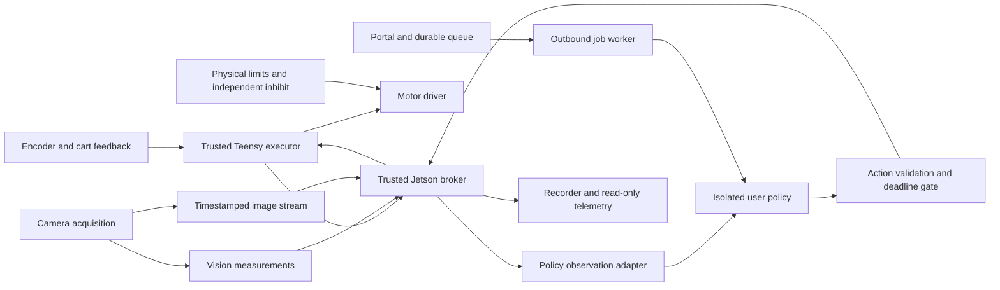

# Cartpole v2 roadmap

## Outcome

People develop a Python controller or RL policy locally, exercise it in simulation,
and submit an immutable artifact for an exclusive, time-limited rig experiment.
Policies can consume magnetic encoder measurements, calibrated vision, images,
or explicitly configured estimates/fusion. They cannot change the owner-controlled
safety envelope or directly access the Teensy. Single, double and triple pendulum
rigs share an interface while declaring different sensors, topology and limits.

The user selected **offline measurement foundation first** on 2026-10-12. Another
session owns all current powered work. This roadmap does not authorize concurrent
hardware access or establish readiness to run any v2 hardware command.

## Approach

**Recommended: selective migration into a separate project.** Retain tested
algorithms and executor behavior, introduce shared measurement/policy contracts,
and port only what each milestone needs. This preserves evidence while allowing
interfaces to change before public adoption.

Extending `deployment` in place would reuse more of its structure immediately, but
would couple v2 work to a busy repository and preserve a single-encoder public
interface. A complete rewrite or immediate distributed robotics framework would
discard useful regression coverage and add deployment complexity before timing
requirements are measured. Neither is justified by the current evidence.

## System boundaries

The diagram shows intended boundaries; components beyond the inherited prototypes
are not implemented. Physical inhibit wiring must be designed and commissioned.

**Policy authority:** a policy receives observations and returns one bounded action.
It cannot arm, home, flash, calibrate, reset faults, renew its own job authorization,
or enlarge limits. Start with an acceleration request in m/s² because it matches
the stepper trajectory governor; the request is not a claim of measured acceleration.
Log requested, accepted/governed, and measured motion separately. Extend action
modes only when their semantics can be modeled and validated consistently.

**Owner authority:** a separate operator interface commissions the rig, chooses
sensor/calibration versions, sets conservative task limits, prepares/resets episodes,
and explicitly grants a run. Physical reset is a supervised workflow initially;
Gymnasium `reset()` must never imply arbitrary unsupervised hardware movement.

**MCU authority:** pulse timing, fixed ceilings, command freshness/sequence checks,
fault latching and local limit reactions remain on the Teensy. Commands expire
relative to the observation they used, not the time a delayed packet arrives.
A stalled policy cannot remain alive because another process repeats its last action.
Define fault-specific stop behavior from measured coasting/braking and containment;
turning off a driver alone is not a guaranteed stop. Electrical inhibition remains
available independently of untrusted software and host health.

**Host authority:** one trusted broker owns the device connection. It bounds
observation age, action delivery, experiment duration and per-policy resources.
The internet schedules work and transports results; it is outside the balance loop.
Sensor choices affect a policy's observations, not the mandatory safety inputs.
Vision-only policies can coexist with owner-required independent safety sensing.

**Simulation:** use the existing MJCF model and Python backend as a starting point.
MuJoCo's Python API supports model/data stepping; engine plugins add specialized
sensor/actuator/force behavior. We have no demonstrated need for a compiled engine
plugin yet. Model the actual bounded stepper drive and sensing pipeline, rather
than treating a force-driven ideal cart as equivalent hardware.
[Python API](https://mujoco.readthedocs.io/en/stable/python.html),
[engine extensions](https://mujoco.readthedocs.io/en/stable/programming/extension.html).

## Milestones and completion evidence

| Order | Deliverable | Completion evidence and dependencies |
|---|---|---|
| 1 | **Offline measurement foundation**: observation/calibration/time schemas, legacy file adapters, headless replay, quality report | Deterministic replay, preserved source identities, strict invalidity/gap handling, explicit unavailable comparisons. Existing videos work without the rig. Detailed first-slice spec is linked below. |
| 2 | **Vision commissioning and synchronized acquisition**: calibrated geometry, fixed exposure/lighting, one camera owner, encoder/video recording | After exclusive rig handoff: stationary and moving accuracy, full-travel distortion, dropout/reacquisition, actual exposure/transport latency, clock mapping/drift and timing tails. Separate fast-motion and stationary metrics. Passive work precedes powered excitation. |
| 3 | **Safety executor and trusted broker**: physical limits, inhibit interface, safe lifecycle, fresh action protocol, local run ownership | Native fault tests, unloaded electrical tests, supervised stopping-envelope measurements, sensor/disconnect/host-stall tests, missed-step strategy, shared-enable handling. Required before v2 powered identification or policies. Firmware and broker development can proceed locally during milestone 2. |
| 4 | **System identification and validated simulation**: measured assembly, passive/driven datasets, uncertainty, holdouts | Encoder calibration/repeatability, independently measured cart response, identifiable parameter fits and residuals on separate runs. No simulator parameter set promoted solely because it fits its own generated data. |
| 5 | **Public SDK and baseline policies**: common observation/action interface, replay/simulation adapters, Gym tasks, classical and RL examples | Same policy logic works through both adapters; simulated delay/dropout/governor matches measurements; seeded evaluations; robust upright balance and swing-up scored separately. Supervised physical deployment follows milestones 2–4. Small SDK contracts start in milestone 1. |
| 6 | **Isolated runner and local queue**: artifact manifest, admission checks, exclusive lease, resource limits, cancellation, result bundle | First use owner-reviewed controllers. Test infinite loop, crash, memory/output/process exhaustion, malformed action/model, stale worker and interrupted job. Rig remains unavailable until a trusted reset/readiness check completes. Public arbitrary code waits for validated isolation on the actual platform. |
| 7 | **Internet portal and durable scheduling**: auth, immutable uploads, quotas, queue, outbound worker, status/video/results | Multi-user lifecycle tests, cancellation and cloud-loss behavior, immutable artifact/config hashes, no duplicate physical execution after reconnect, read-only telemetry cannot affect control. Portal is the last major layer. |
| 8 | **Double/triple pendulum commissioning**: extra joint observations, model/config, policy tasks and revised safety envelope | Separate link identification and occlusion tests, joint-axis/sign checks, coupled-dynamics identification, independent holdouts and new physical containment/limit validation for each assembly. |

The plan front-loads shared contracts, vision and passive measurement. It moves
commissioned safety ahead of **powered** system identification, not just ahead of
RL. SDK/simulation coding can proceed locally with provisional profiles, but
simulation accuracy claims and physical execution depend on measured evidence.

## Measurement and topology rules

- SI units; cart +x fixed by the rig calibration; upright angle zero, positive
  tilt toward +x. Preserve the camera's image coordinates and its explicit transform.
- Raw sensor samples, derived velocities, fused estimates, and simulated truth
  are distinct data products. A sample retains source, units, calibration, sequence,
  clock/boot identity, measurement-time semantics, arrival time, validity and reason.
- A missing or stale value is absent/invalid, never a zero-valued valid measurement.
  Unknown covariance stays unknown; a detector quality score is not uncertainty.
- Expose magnetic and vision angles independently. Fusion is optional and versioned;
  adding an EKF before establishing timing and sensor failure modes would hide errors.
- Support named joints/links from the beginning. Vision observes a link's absolute
  world angle; an articulated model generally uses joint-relative angles. Conversion
  requires the declared topology and valid parent measurements. The first detector
  advertises exactly one link; unsupported configurations fail explicitly.
- Policy inputs may be selected state fields, multiple independent sensor streams,
  or bounded timestamped image histories for end-to-end visual policies. No policy
  gets a raw camera device handle. Multi-rate observations include age and validity.
- Training uses simulated observations with realistic timing/noise/dropouts. Ground
  truth may be a declared training/evaluation channel, never a hidden deployment input.

## Identification sequence

1. Record assembly dimensions/masses/COM, drive geometry/microsteps, usable travel,
   sensor mounting and calibration hashes. Re-establish encoder mechanical coupling,
   magnet status, zero/sign, repeatability and nonlinearity.
2. Measure stationary noise and reference poses/travel; calibrate camera distortion
   and the motion plane. Establish clock mapping and its uncertainty. Driver timestamp
   flags distinguish clock and event semantics; they must be inspected, not assumed.
   [Linux V4L2 buffer documentation](https://www.kernel.org/doc/html/latest/userspace-api/media/v4l/buffer.html).
3. Clamp the cart mechanically and collect passive releases across directions and
   amplitudes. Fit effective length, damping and where supported dry friction.
   Free decay alone does not independently identify mass, COM, inertia and motor torque.
4. After safety commissioning, apply bounded excitations inside the measured travel
   and stopping envelope. Log policy request, governor output, emitted steps and
   independent physical x(t). Fit delay, response, friction/backlash/compliance and
   failure limits only where data support identifiability.
5. Validate on separate releases, amplitudes and driven runs. Preserve uncertainty,
   correlations and residual structure; use these to choose domain randomization.
   Measure policy observation-to-action timing under representative Jetson load.

## Later decisions to resolve at the relevant milestone

The first offline slice is independent of these facts. Before live work, obtain a
dated handoff from the tuning session: current assembly, running firmware/config,
encoder status, camera attachment/exposure controls, installed switches/inhibit and
availability of independent cart sensing. Before the runner, establish Jetson model,
OS/JetPack, CPU/GPU budget and feasible isolation. Before public release, decide
licensing, acceptable policy dependencies, job quotas, reset staffing and publication
of videos/data. None requires interrupting the current tuning session.

## First implementation slice

Review [the offline measurement foundation specification](specs/2026-10-12-measurement-foundation.md).
It is intentionally useful without live hardware, a portal, a trained policy, or a
new firmware image. Implementation then proceeds in small testable changes.
