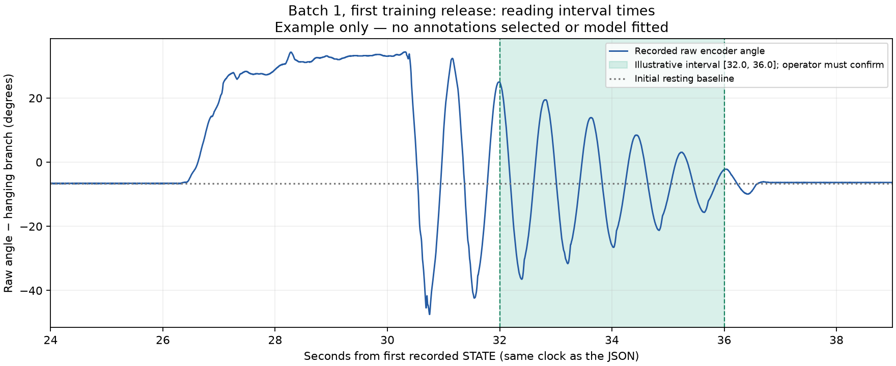

# Operator batch 1: raw-data review, 2026-10-17

Recommendation: keep `passive-train-01` and `passive-validate-01` as candidates for the first annotated passive fit. Do not discard them because nominal 60-degree releases were difficult to reproduce. No model was fitted, no free intervals were accepted, and no annotation on the Jetson was changed during this review.

The read-only copies came from `/home/rbafna/cartpole-v2-live/staging/operator-id-20261017/runs/` on `rbafna@jetson`. The raw JSONL files were losslessly compressed; decompressed hashes match their original completion reports. Camera completion reports are retained; the full camera streams remain on the Jetson and were not evaluated here.

| Check | Training | Validation |
| --- | ---: | ---: |
| Recorded states | 45,047 | 45,046 |
| Duration | 180.054 s | 180.054 s |
| Median snapshot rate | 250 Hz | 250 Hz |
| Largest snapshot gap | 4 ms | 4 ms |
| Duplicate/reversed timestamps | 0 / 0 | 0 / 0 |
| Host logger losses | 0 | 0 |
| Unhealthy passive states | 0 | 0 |
| Initial resting raw angle minus pi | -6.592 degrees | -6.416 degrees |
| Final resting raw angle minus pi | -6.416 degrees | -6.504 degrees |
| Saved upright reference / home epoch | 330 / 15 | 330 / 15 |

Both completed with STOP confirmed and distinct session/source identities. The firmware's cumulative transmit-drop counter increased by one in each recording; this is distinct from host logger losses. Neither record has a board-snapshot gap above 4 ms. Counted cart position and commanded motion remained zero; with the motor disabled, this does **not** independently prove that the cart was physically stationary. Operator-reported hand restraint remains an assumption.

Visual review shows eight separated decay sequences in each trace. The complete raw angle range includes manual lifting and holding, so it must not be described as a verified free-release amplitude. Around a -6.5-degree resting baseline, a plotted +40-degree pose represents about 46.5 encoder degrees of displacement. Later decaying peaks are smaller than the initial pose. None of these calculations establishes a globally calibrated physical angle.

The saved training annotation snapshot still has `selected_before_scoring: false` and an empty `episodes` list. The next step is to identify hand-clear intervals from the plot and the operator's release observations, enter those times in the JSON, then freeze the annotations before fitting/scoring. Keep the generated source hash. The same process is needed for validation. A raw-data quality review does not consume a holdout; using validation prediction errors to revise the model does. Batch 2 can then provide a fresh holdout and better 60/90-degree coverage.

## How to read annotation times



The shaded `[32.0, 36.0]` interval demonstrates the clock and JSON syntax only. It is **not an approved interval** and deliberately omits the initial large motion. The operator must confirm that an actual chosen interval excludes handling and includes enough free oscillations. To retain the initial-amplitude information, choose an earlier start only when the hand-clear time is established. This review did not alter or create an accepted annotation file.

```json
{"episode_id": "release-1", "board_relative_s": [32.0, 36.0], "reason": "replace with an accurate explanation after confirming hand-clear motion"}
```

## Reproduce the review

From the repository root, choose a new output directory:

```sh
uv run --extra id --extra plots python \
  evidence/operator-batch1-20261017/review_batch.py \
  --output runs/operator-batch1-review
```

This uses only the archived copies, checks their original completion/hash admission, produces both full raw plots and the illustrative zoom, and writes a numerical quality report. It never opens serial, fits a model or selects intervals. Generated results are in [`review/`](review/), with numerical checks in [`quality-report.json`](review/quality-report.json).
