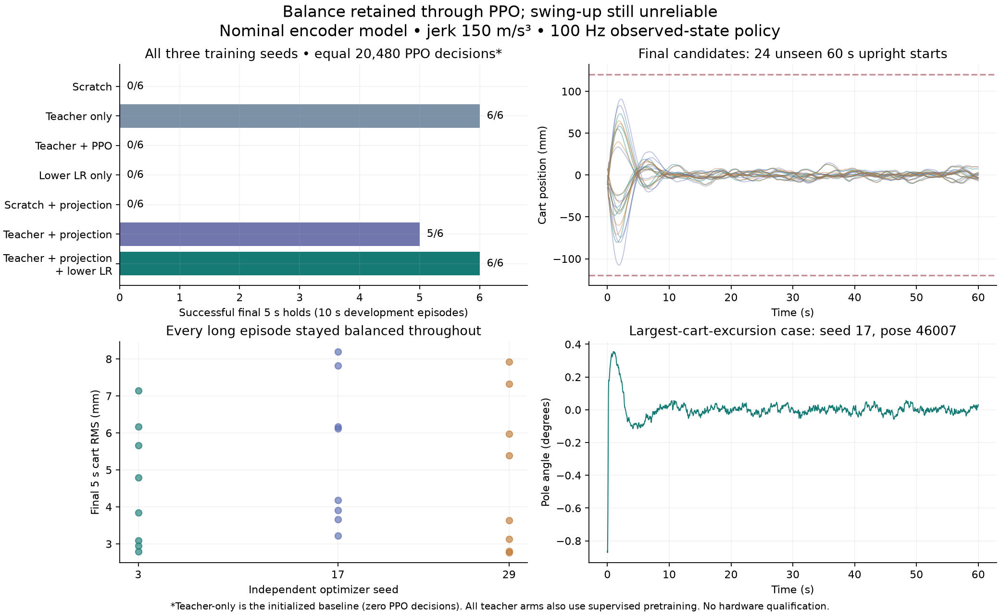

# Local balance learning — October 18, 2026

The first local cycle established **retained nominal balance**, not reliable
swing-up or hardware transfer. All three final constrained PPO networks passed
all eight fresh 60-second upright trials: **24/24**, every sample within the
balance bounds, with no faults. Their mean final-five-second cart RMS was
**4.56–5.41 mm**. The largest transient cart displacement was **107.71 mm**.
Hanging-start probes succeeded in only **1/6** cases.



## What ran

The M3 Pro ran serial environments and single-thread CPU PyTorch workers, with
independent runs in parallel. Each network is a 64×64 tanh MLP. Twenty completed
training trials consumed **409,600 online decisions**: 20,480 per trial. In
addition, the teacher search evaluated 68 trajectories. No hardware was commanded
and no active Colab training recipe was changed.

The environment retains 100 Hz policy decisions, 1 ms physics/executor steps,
delayed and quantized encoder observations with a causal rate observer, one
motion governor, raw acceleration bounds ±25 m/s², and jerk 150 m/s³. The actor
uses the SDK observation contract and receives no simulator truth. Dynamics and
sensor parameters were nominal; no variation or vision/fusion was evaluated.

Training episodes lasted 5 seconds. Each development checkpoint was evaluated on
the same two 10-second upright poses (43000, 43001). Optimizer seeds were 3, 17,
and 29. All teacher-initialized arms additionally received 1,500 supervised
updates on 8,192 synthetic observed states, with 4,096 separate validation states.
They therefore have more prior information and extra compute than scratch arms.

| Recipe | Learning rate | Development holds |
|---|---:|---:|
| Scratch, ordinary PPO | 0.00003 | 0/6 |
| Improved teacher initialization, before PPO | — | 6/6 |
| Teacher initialization + ordinary PPO | 0.00003 | 0/6 |
| Teacher initialization + slower PPO | 0.000003 | 0/6 |
| Scratch + zero-equilibrium constraint | 0.00003 | 0/6 |
| Teacher + zero-equilibrium constraint | 0.00003 | 5/6 |
| Teacher + constraint + slower PPO | 0.000003 | 6/6 |

Every trained arm above has the same 20,480-decision budget. The initialized
baseline has zero online decisions. Two earlier trials using an intermediate
teacher are also preserved, bringing the total to 20; they are exploratory,
not a three-seed comparison. A low-rate constrained scratch arm was not run, so
the final recipe does not yet have that exact matched control. The standard-rate
ordinary and constrained scratch/teacher comparisons are matched.

These are adaptive experiments, not a preregistered statistical comparison.
Changing update size and adding the constraint were responses to observed
failures. Every seed and failed attempt remains in the archives.

## What the failures taught us

The improved nominal teacher is:

```text
raw acceleration = clip(1*x + 2*v + 40*theta + 2*omega, -25, 25)
```

It acts on observed values only. Local analysis including the fitted hinge
friction suggested smaller cart feedback and stronger angle feedback. Full
simulation testing, rather than that approximate linearization, selected the
teacher. Compared with the original host teacher, the selected law reduced mean
cart RMS from 80.52 to 14.51 mm and worst final-window cart peak-to-peak motion
from 236.09 to 9.68 mm in six 25-second development runs. Raw action-change RMS
increased from 0.0424 to 0.0686 m/s² per sample even though total raw acceleration
RMS fell; the unchanged governor limits executed jerk. These simulation gains
were not applied to the real rig.

Ordinary PPO retained angle stabilization but introduced a constant acceleration
bias and weakened cart centering. In all six final development failures, the
cart first crossed the 120 mm centering bound while the pole was still close to
upright. Removing the equilibrium bias from those frozen actors rescued all six
probes. The archived `bias-diagnostic` contains the executable analysis, pinned
inputs, and complete traces.

The new `equilibrium` option adjusts the actor's final output bias after
initialization and every PPO rollout update so a stationary, centered, upright
observation produces zero mean action. Evaluation still uses an ordinary neural
network, with no teacher fallback. This is constrained PPO; it does not preserve
all feedback gains or guarantee the usual PPO surrogate-update bounds. Logs
include post-projection KL.

Projection alone passed five of six development trials. The remaining candidate
had reversed its local cart-position feedback sign. Reducing the learning rate
by ten while retaining projection preserved balance in all three seeds. A smaller
learning rate alone did not work. These results support **retention**, not a claim
that PPO improved an already competent teacher.

## Longer evaluation and limits

The final candidate rule selected all three final 20,480-decision networks, with
no best-seed or best-checkpoint selection. The protocol fixed eight new pose
seeds (46000–46007) and a 60-second duration before inspecting those results.

| Optimizer seed | Full-duration balanced trials | Mean final 5 s cart RMS | Worst transient abs(x) |
|---|---:|---:|---:|
| 3 | 8/8 | 4.56 mm | 80.31 mm |
| 17 | 8/8 | 5.41 mm | 107.71 mm |
| 29 | 8/8 | 4.87 mm | 70.85 mm |

All 1,440 simulated seconds met `abs(theta)<0.15 rad`, `abs(omega)<1 rad/s`, and
`abs(x)<0.12 m`, with no faults. The 120 mm centering criterion is stricter than
the approximately 309 mm model rail half-range. The worst initial transient left
only 12.29 mm to that centering criterion; the small settled RMS should not hide
this excursion.

These resets were small: angle ±0.07 rad (about ±4°), cart position ±15 mm, cart
velocity ±0.025 m/s, and angular rate ±0.15 rad/s. Wider capture, disturbance
rejection, model uncertainty, observation failures, and real hardware remain
untested here. Three optimizer seeds and eight poses provide a useful regression
suite, not a broad reliability guarantee.

The three initialized networks also passed 24/24 earlier 60-second trials on
seeds 45000–45007. That initial evaluation used different poses, so it is not a
paired comparison demonstrating improvement. The archived protocol amendment
explicitly states it was written after those initial results were inspected.

Separate 25-second hanging probes (47000, 47001 for each network) produced one
successful final five-second hold out of six. No swing-up curriculum has yet been
trained in this local harness. The next development step is to expand capture
conditions and then train swing-up while rerunning this balance regression suite,
followed by measured dynamics/timing variation and vision/fusion observations.

## Reproduce and inspect

See [the runnable guide](../../docs/balance-learning.md) for new training runs,
matched controls, fresh-seed evaluation, and the full metric definitions.

For example, from the repository root:

```sh
./scripts/balance-learning train \
  --profile training/profiles/rl-encoder-20261017 \
  --initialization teacher --seed 3 --steps 20480 --every 4096 \
  --gains evidence/rl-balance-20261018/teacher-gains.json \
  --constraint equilibrium --learning-rate 0.000003 \
  --output runs/my-balance-seed3
```

Use a new output directory each time. Repeat with optimizer seeds 17 and 29.
The checkpoint evaluator refuses source or checkpoint mismatches.

`archives.json` contains SHA-256 digests, sizes and member counts. Both archives
were read back and each member compared byte-for-byte by hash with the source.
Restore into an empty folder:

```sh
mkdir runs/restored-balance-20261018
tar -xJf evidence/rl-balance-20261018/learning-runs.tar.xz -C runs/restored-balance-20261018
tar -xJf evidence/rl-balance-20261018/teacher-runs.tar.xz -C runs/restored-balance-20261018
./scripts/replay-balance-evaluation \
  runs/restored-balance-20261018/local-balance-20261018/projected-slow-seed3 \
  --seeds 48000 48001 --seconds 60 --output runs/my-frozen-source-replay
```

Replay verifies the archive bindings and runs the original evaluator from its
frozen source with the installed pinned dependencies. It does not install
packages. Candidate hashes are listed in `candidates.json`. Teacher provenance
paths in `teacher-gains.json` are relative to the restored teacher archive root.

`cycle-summary.json` includes per-seed metrics. Regenerate the figure and summary:

```sh
uv run --extra rl python evidence/rl-balance-20261018/tools/plot_cycle.py \
  --runs runs/restored-balance-20261018/local-balance-20261018 \
  --output runs/my-balance-cycle-summary
```

The archives preserve every checkpoint, exact source ZIP, recipe, evaluation,
protocol and full trajectory, including failed experiments. No deployable
`actor.json` is produced. `hardware_accepted` and `deployable` remain false.

## Verification

The full project suite passed **1,445 tests**, with **7 skipped** and **456
subtests passed**. Independent review checked all 20 completed trial bindings,
teacher hashes, replay provenance, and recomputed long-run metrics from the
trajectories. Final code also includes tests for actor-only imitation, RNG
preservation, checkpoint accounting, recipe/source mismatches, projection, and
safe frozen-source replay.

One logging limitation remains in the preserved experiment versions: the final
chunk's optimizer metrics were not flushed to CSV. Its checkpoint and evaluation
were correctly saved after the update. The current harness explicitly flushes
those final metrics, with a regression test. Frozen source is preserved rather
than silently replacing it with the corrected version.
