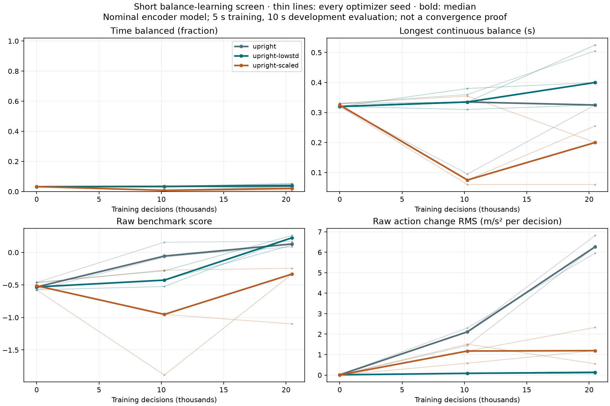
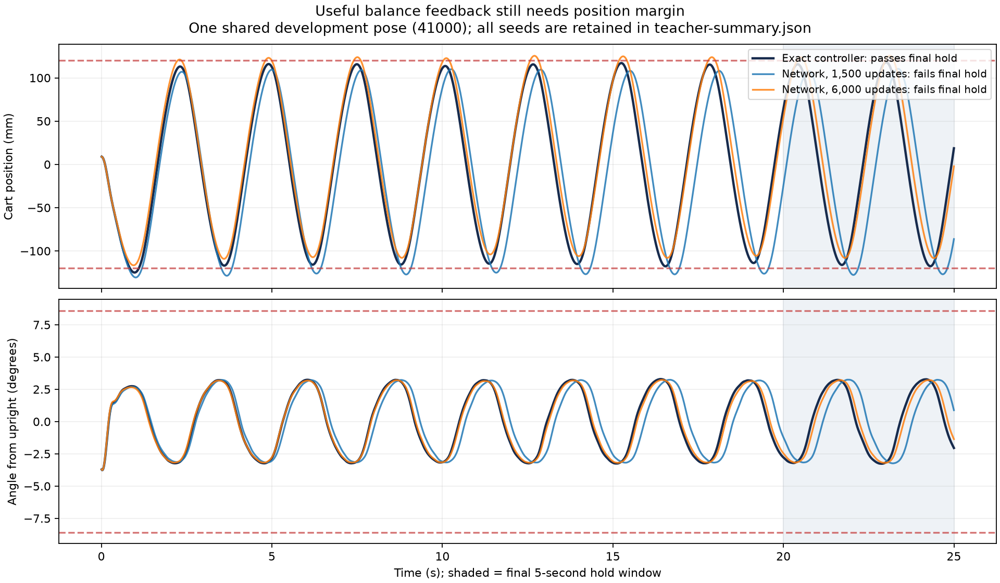

# Local RL development screen — 2026-10-17

Short tests diagnose learnability and select experiments; they do not prove future
convergence. This entire exercise was offline. No cloud job, production recipe,
firmware, hardware setting or deployed actor was changed. Runtime baseline:
`bb032fc957d754fab93502791cb0638a023aed6f`; added diagnostic source is frozen inside
each run's `source.zip`, with hashes and dependencies in its recipe/report.

## Conclusions

The simulated task is controllable through the actual observed-state input and
motion governor. The existing Python controller passed all four 25-second upright
cases, including the final continuous five-second hold. Learning from its local
balance law produces useful neural feedback quickly. Short PPO runs from random
initialization have not shown sustained balance yet. No learned candidate passed
the full final-hold criterion, so no diagnostic checkpoint was promoted.

A strict balanced sample requires all three: `abs(wrapped theta) < .15 rad`,
`abs(omega) < 1 rad/s`, `abs(x) < .12 m`. The final hold requires every sample in
the final five seconds to meet those bounds. This is stronger than the legacy
`success` field (ever balanced briefly); we use `hold_success` for decisions.
The ±120 mm centering criterion is separate from the approximately ±309 mm rail
boundary. Crossing the former is a performance failure, not a physical rail hit.

## Nine matched short PPO probes

Frozen pre-trial settings: [method.json](method.json). Three optimizer seeds per
variant,20,480 steps each;128 configured training pose seeds, five-second nominal
upright episodes; independent ten-second upright and hanging evaluations at
0/10,240/20,480 steps. Only about40 completed training episodes/unique poses were
visited per run, not the full128-pose pool. Each ablation changes one factor.

| Variant | Upright balanced fraction, median [range] | Final 5-second holds |
| --- | --- | --- |
| Baseline | 3.60% [3.25–5.05%] | 0/6 |
| Initial action std .05 instead of1 | 4.00% [3.25–5.25%] | 0/6 |
| Fixed observation scaling | 2.00% [0.60–2.55%] | 0/6 |

Each fraction is averaged across two evaluation poses for an optimizer seed;
medians/ranges are across the three optimizer seeds. All hanging evaluations also
failed final hold. These tiny, nominal balance probes differ from the25-second
randomized mixed-start Colab runs and cannot predict their eventual outcome.
Reward increased without corresponding sustained balance. Smaller exploration
reduced command variation substantially but did not solve control. Scaled inputs
were not a winner in this small budget. Retain every seed rather than selecting
the best run. Wall times reflect concurrent workers and are not fair speed tests.



## Supervised initialization diagnostic

This is imitation of the existing balance equation, not evidence of PPO
convergence. The same64×64 actor sees observed-state features only. Synthetic
training8192/validation4096 states have independent sample seeds. Only actor
weights receive supervised gradients; the teacher is never called during neural
rollouts. The dataset covers a local upright neighborhood; no global swing-up
teacher or hardware data enters this fit.

| Initialization / fit updates | Validation action RMSE (m/s²) | Upright balanced fraction | Final holds |
| --- | --- | --- | --- |
| Seed3 /1500 | .03028 | 89.94% | 0/4 |
| Seed17 /1500 | .03740 | 87.90% | 0/4 |
| Seed29 /1500 | .11048 | 77.69% | 0/4 |
| Seed3 /6000, adaptive follow-up | .03668 | 93.08% | 0/4 |
| Exact existing controller, same poses | n/a | 99.67% | 4/4 |

All neural upright rollouts kept angle and angular speed within their limits
throughout25seconds. Every failed balanced sample was a cart-position violation.
The mean episode maximum |x| was129/131/154mm across the three initial fits and
125mm for the longer fit. The exact controller itself oscillates and has only
about1.8–3.7mm position margin in its final windows; copying it is a useful
feasibility test, not an ideal centering solution. No upright case faulted or
needed rail braking. The6000-update result improved closed-loop fraction while
worsening aggregate fit RMSE: neither fit error nor reward replaces rollout tests.



All rows, trajectories and separate hanging results are retained in
[teacher-summary.json](teacher-summary.json) and the archives. The figure uses
one shared development pose to show the failure mechanism; it is not the only
case measured. The longer seeds41000–41003 are now inspected development cases.
Original reports contain the historical key `confirmation`; interpret it as
longer evaluation. The6000-update follow-up reused those poses and is regression,
not independent confirmation. The public script now calls this `longer_evaluation`.
The exact original script is retained separately and pinned by each old report.

## What this suggests testing next

First, improve centering margin and test a controller-initialized actor against
random initialization at equal PPO budgets. Keep the existing controller as a
reference, not as a hidden fallback during evaluation. A short upright curriculum
can concentrate data on recovery; evaluate on the unchanged harder cases so an
easier training reset cannot masquerade as improved performance. After repeatable
balance, add swing-up/capture, then dynamics uncertainty and camera modes.

The initial Gaussian action std1 maps to25m/s²; with jerk150m/s³ many different
requests produce the same immediate governed motion. This is intentional motion
limiting, not evidence of a scaling bug. Smaller std is a testable learning choice,
not permission to remove the governor. The observations also have different
scales, and the task has hidden delay/observer states; these are hypotheses to
study, not demonstrated reasons PPO cannot converge. No deterministic software
bug preventing balance was established by the independent environment audit.

Final qualification needs a frozen recipe, more optimizer seeds, larger fresh
pose sets, disturbances,25–60second holds, and randomized timing/dynamics. The
model remains DEVELOPMENT_ONLY; nominal simulation success does not qualify
hardware transfer or global swing-up. Encoder-only tests here do not validate
vision/fusion policies. Existing cloud jobs remain useful long-run reference data.

## Reproduce, inspect and verify

The runnable workflow is [docs/rl-development-cycle.md](../../docs/rl-development-cycle.md).
From the repository root:

```sh
./scripts/rl-diagnostics pilot \
  --profile training/profiles/rl-encoder-20261017 \
  --variant upright-lowstd --seed 3 \
  --steps 20480 --every 10240 --output runs/my-balance-probe

uv run --extra rl python evidence/rl-diagnostics-20261017/tools/teacher_probe.py \
  --profile training/profiles/rl-encoder-20261017 \
  --seed 3 --output runs/my-teacher-probe

python3 evidence/rl-diagnostics-20261017/tools/verify_archives.py
```

All original runs, recipes,84 files including checkpoints/source/episode logs,
are stored in `screen-runs.tar.xz` and `teacher-runs.tar.xz`; member and archive
hashes are in `archive-manifest.json`. Archives contain trusted project outputs.
To restore on a fresh checkout where the corresponding `runs/` paths do not exist:

```sh
tar -xJf evidence/rl-diagnostics-20261017/screen-runs.tar.xz
tar -xJf evidence/rl-diagnostics-20261017/teacher-runs.tar.xz
uv run --script evidence/rl-diagnostics-20261017/tools/summarize_teacher.py \
  --output runs/reproduced-teacher-summary
```

For exact historical runtime restoration, unzip a run's `source.zip` into a new
empty checkout and overlay the two files under `runtime-supplements/`, retaining
their relative paths. They are unchanged package resources omitted from the early
snapshots; future diagnostic snapshots include them. Use the frozen teacher script
for old experiment reproduction, the renamed public script for new experiments.
Use the archived dependency lock and recipe version pins. Bitwise equivalence
across different platforms is not promised. Evaluation preserves training RNG;
an independent split-versus-continuous tiny PPO check produced identical weights.

## Verification

Independent review found and fixed summary comparison, recipe identity and source
archive integrity gaps, with failing tests before repairs. The completed suite:
**1409 passed,7 skipped,456 subtests passed**. Focused diagnostic tests:6 passed.
See `verification/` for test output and `feasibility/` for independent positive
controls and action-response measurements. Archives were verified without loading
serialized models. Current diagnostic checkpoints intentionally have no deployable
SDK `actor.json`.
