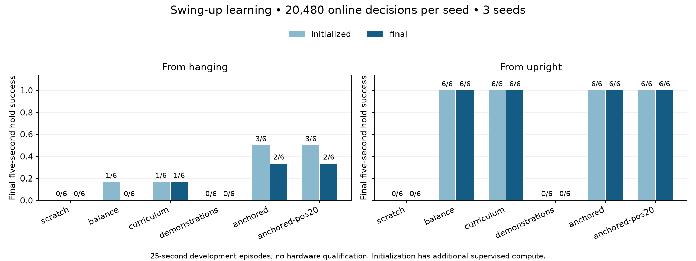
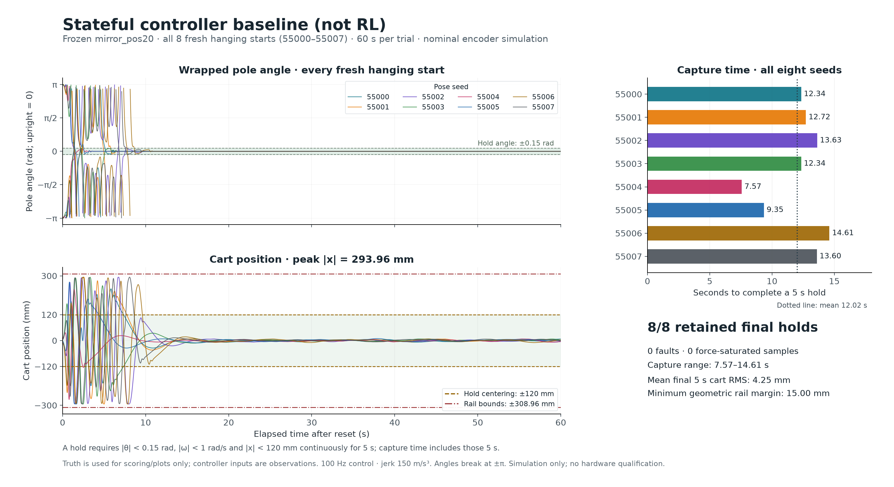
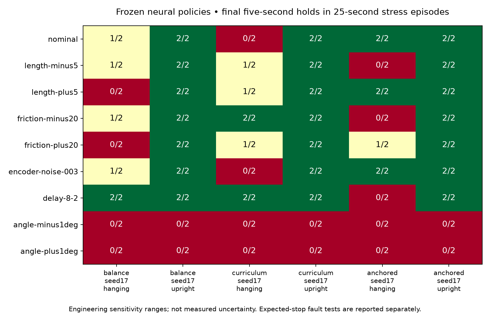

# Swing-up learning and offline transfer checks — 2026-10-18

**Status: DEVELOPMENT_ONLY. No policy from this cycle is accepted for hardware.**
All work was local simulation on the M3 Pro; the unpowered rig and existing Colab
jobs were untouched. The experiment produced a combined swing-up/balance neural
candidate, a stronger stateful controller baseline, and concrete reasons not to
interpret nominal simulation success as hardware readiness.

## Result

Eighteen PPO trials used optimizer seeds 3, 17 and 29, **20,480 online decisions
per trial** (368,640 total). Development evaluation used the same two pose seeds,
53000/53001, from hanging and upright for 25 seconds. All failures are retained.
These repeatedly inspected poses are not a final test set.

| Initialization/training recipe | Hanging final holds | Upright final holds |
| --- | ---: | ---: |
| Scratch, mixed resets | 0/6 | 0/6 |
| Balance initialization, mixed resets | 0/6 | 6/6 |
| Balance initialization, staged resets | 1/6 | 6/6 |
| Plain swing demonstration initialization | 0/6 | 0/6 |
| Demonstrations + synthetic balance anchor | 2/6 | 6/6 |
| Improved demonstrations + same balance anchor | 2/6 | 6/6 |

Each denominator is three optimizer seeds × two pose seeds. Initialized actors
and intermediate checkpoints are also retained. Supervised initialization uses
additional compute and controller knowledge; equal online budgets do not mean
equal compute or prior information. The final comparison changes only the
teacher dataset, keeping the anchor and online recipe fixed.



The selected `anchored-seed17` final checkpoint passed both development hanging
starts, then **5/8 fresh hanging and 8/8 fresh upright** tests at 60 seconds on
pose seeds 56000..56007. Upright balance remained uninterrupted at the sampled
resolution, with mean final-window cart RMS 3.00 mm. Hanging was not consistently
fast: successful first one-second captures occurred at 11.93, 12.23, 20.10,
51.90 and 53.14 seconds. Two of five eventual successes took over 50 seconds;
three starts failed. See [all long-run metrics](anchored17-fresh60-summary.json).
No further tuning used those fresh outcomes in this cycle.

The gate requires the complete horizon, no fault, and every final-five-second
100 Hz sample satisfying `|theta|<0.15 rad`, `|omega|<1 rad/s`, `|x|<0.12 m`.
It does not imply an uninterrupted hold since first capture or continuous
between-sample enforcement. Full traces retain those distinctions.

## What the iteration learned

Plain behavior cloning had held-out raw-command RMSE around 0.49–0.51 m/s² but
destroyed balance. At the observed upright equilibrium, the seed17 actor's
angle feedback derivative fell from about 40.47 to 0.05 while its dependence on
previous acceleration rose to about 0.77. It learned a correlated-action
shortcut rather than the required restoring response. These are local actor
derivatives, not a complete stability analysis; see
[the reproducible feedback diagnostic](feedback-diagnostic.json).

Balance anchoring adds independently sampled near-upright states and the known
`x + 2*v + 40*theta + 2*omega` target to the imitation objective, with weight 10.
It restores angle feedback and preserves balance across all three optimizer
seeds. It does not guarantee swing capture. Both original and improved teacher
datasets gave 3/6 initialized hanging holds; after PPO, each aggregate ended at
2/6. Several intermediate checkpoints were better than their final checkpoint.
PPO refinement can erase useful behavior even at learning rate 0.000003.

The current teacher has hidden state (kick timing, swing/balance hysteresis,
reflection and settled latch), while the neural actor is memoryless. This is a
plausible source of inconsistent imitation targets, not a proven sole cause.
The 10-second training horizon can also end before some successful teacher
captures. These motivate controlled tests of behavior retention during PPO,
longer task-aligned horizons and explicit policy memory/phase handling rather
than automatically spending a much larger cloud budget on the same recipe.

## Improved controller baseline

The exploratory teacher starts from the preserved observed-state host controller,
reduces `swing_position_gain` to 20, reflects its controller coordinates according
to initial observed cart-position sign, and switches to the quiet linear balance
law only after a settled capture. The settled latch requires host balance mode,
`|theta|<.15`, `|omega|<.75`, `|x|<.25`, `|v|<.05`; it releases when the host
controller returns to swing mode.

The first candidate passed six development poses but generalized poorly to a
broader set: original demonstrations held only 9/16 hanging starts. Expanded
search retained failures, fixed the revised candidate before testing new poses,
and then passed **16/16 fresh 60-second tests** (8 hanging, 8 upright;
55000..55007). From hanging, first-five-second hold time averaged 12.02 s, range
7.57–14.61 s. Mean final cart RMS was 4.25 mm. All eight upright episodes stayed
balanced for the full 60 s. No faults or force saturation occurred.

This is a **stateful controller baseline, not a learned neural policy**. Its
swing-up reached about ±293.962 mm on a rail with half-range 308.962 mm, leaving only
15 mm geometric margin and invoking modeled rail braking. One upright transient
came within 1.95 mm of the stricter 120 mm centering criterion. Nominal success does
not qualify these margins physically.



The improved dataset contains 80,000 observed-before-action rows from 32/32
successful 25-second episodes. Whole pose IDs 21000..21011 are training and
21012..21015 are validation, with both start families kept together. Every row was
checked against its causal trace. Both original and improved datasets remain
archived. The teacher audit covers 184 episodes, 462,000 decisions and 50 failed holds.
See [teacher results](teacher-summary.json) and [audit](audit.json).

## Transfer tests and a real weakness

Three frozen final neural checkpoints were evaluated on 11 declared scenarios,
2 fresh stress poses 54000/54001 and both starts: 132 episodes total. Nine scenarios
require task success; two require fault detection. Their finite ranges are
engineering sensitivities, not measured uncertainty or probabilities.



For the selected anchored candidate:

- Nominal hanging 2/2; effective length −5%: 0/2; length +5%: 2/2.
- Dry friction −20%: 0/2; friction +20%: 1/2; encoder noise σ=0.003 rad: 2/2.
- Telemetry 8 ms + command 2 ms: hanging 0/2.
- Upright 2/2 in all of those cases, but **0/2 under either sign of 1° angle bias**.
- Excess delay and invalid telemetry produced the expected terminal simulator
  faults. These test detection, not physical stopping distance or a real STOP
  command through the host and firmware.

The weak centering feedback cannot compensate a persistent angle error within
the available rail: the simple law suggests `x≈-40*bias` at zero speed/rate,
about 0.70 m for 1°. This is a diagnostic approximation, not a plant equilibrium
proof. A separate finite observed-state controller screen tested six stronger-centering
laws: all 24 biased cases failed, while 8/12 nominal cases passed. Stronger
feedback reduced mean biased cart offsets to around ±0.06 m, but oscillations
still crossed the ±0.12 m hold boundary. All 36 episodes and 90,000 decisions
completed without simulator faults. No law qualified for the predeclared fresh
confirmation set; all traces and failures are in `centering-runs.tar.xz` and
[the diagnostic summary](centering-summary.json).

Actual numeric SDK actors were exported, hash-loaded, reset and stepped on the
same observations as SB3. Across three checkpoints, **30,000 command comparisons
passed** the 1e-5 m/s² tolerance; maximum discrepancy was 5.64e-6 m/s².
[Parity reports](parity-summary.json) retain local CPU/wall timings, which are
not Jetson timing guarantees.

Conditional command agreement does not imply the same closed-loop trajectory.
For curriculum17, SB3 nominal hanging was 0/2 while the numeric SDK actor was 2/2;
for balance17 it was 1/2 versus 0/2. Initial observations and truth matched;
roughly 1e-6 command differences grew into different capture outcomes. One pair
had 0.281 m cart-position difference by 5 seconds. The anchored candidate was 2/2
through both paths. See [precision sensitivity](precision-sensitivity.json).
This is evidence of fragile capture basins, not a demonstrated export bug.

## What simulation cannot settle yet

[The transfer audit](../../docs/simulation-transfer.md) documents these gaps:

1. The cart plant is an ideal acceleration servo below an assumed 20 N force
   ceiling. Tracking delay, lost steps, motor force versus speed, backlash,
   compliance and disabled-motion behavior are not identified.
2. The passive pendulum fit has useful short forecasts, but does not qualify
   global upright/forced swing dynamics. Smooth dry friction near zero speed is
   a model choice, not identified static stiction.
3. Global encoder mapping/upright uncertainty and current Jetson/transport timing
   remain unqualified. A numeric calibration reference alone cannot certify
   physical vertical.
4. Exact host/firmware STOP replay and later bounded hardware acceptance remain
   outstanding. No model export from this cycle clears hardware admission.

Simulation has established useful software parity and falsified several
fragile candidates. It has **not established “will work on hardware.”** Before
promoting a candidate, require repeatable multi-seed swing-up, fast capture and
long holds on new starts, meaningful rail margin, angle-bias and combined model
stress, agreement through the actual SDK path, and a cart tracking model checked
against physical evidence. Hardware qualification waits for access.

## Reproduce, inspect and restore

[Runnable training/evaluation instructions](../../docs/swing-learning.md) cover
mixed/curriculum training, whole-episode demonstration partitions, anchoring,
60-second tests and stress/parity evaluation. `scripts/swing-transfer-check`
keeps the original frozen loader guards even after the working source changes.
The new default reset hook preserves existing PPO behavior; firmware, live
controls, physical profiles and cloud jobs are unchanged.

All run directories are ignored working data; the committed archives retain
recipes, exact sources, every checkpoint, traces, optimizer logs, both datasets
and failed trials. Each archive has a manifest of every member's SHA-256, and was
read back and checked against its original files. Large archives are split into
48 MiB pieces; manifests include both piece and reconstructed-archive hashes.
Verify reconstructed SHA-256 against its manifest before extraction. Restore
into a new directory:

```sh
mkdir -p /tmp/cartpole-swing-evidence
cat evidence/rl-swing-20261018/neural-runs.tar.xz.part-* > /tmp/cartpole-swing-evidence/neural-runs.tar.xz
tar -xJf /tmp/cartpole-swing-evidence/neural-runs.tar.xz -C /tmp/cartpole-swing-evidence
cat evidence/rl-swing-20261018/teacher-runs.tar.xz.part-* > /tmp/cartpole-swing-evidence/teacher-runs.tar.xz
tar -xJf /tmp/cartpole-swing-evidence/teacher-runs.tar.xz -C /tmp/cartpole-swing-evidence
tar -xJf evidence/rl-swing-20261018/centering-runs.tar.xz -C /tmp/cartpole-swing-evidence
```

Use `tools/summarize.py` to regenerate the matched-group chart;
`tools/plot_stress.py` verifies and plots stress traces; `tools/feedback.py`
records actor derivatives; `tools/archive.py` makes verified archives (system
Python with lzma). Frozen source replay requires the original installed dependency
versions and trusted local source/checkpoints; it never installs packages.

## Verification and review

The full project suite passed **1,524 tests, 7 skipped, 456 subtests**; its exact output
is in [pytest.log](pytest.log). New tests cover curriculum reset boundaries,
demonstration byte races, whole-trajectory splits, actor-only updates/RNG
preservation, balance anchoring, frozen source/weight binding, stress semantics
and actual numeric SDK parity. Independent review found two harness issues
(demonstration reread race and curriculum stage timing), both reproduced and
fixed before anchored trials. Earlier non-demo budgets did not hit those cases.
Independent source-loader/parity review found no outstanding material defect.
Two additional exploratory centering checks passed; no core changes followed
the full suite.
