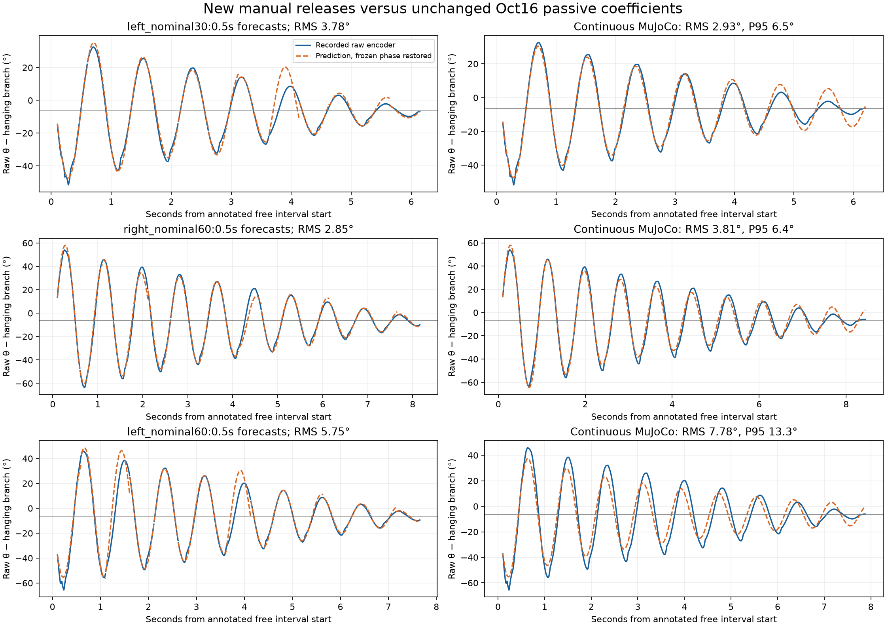
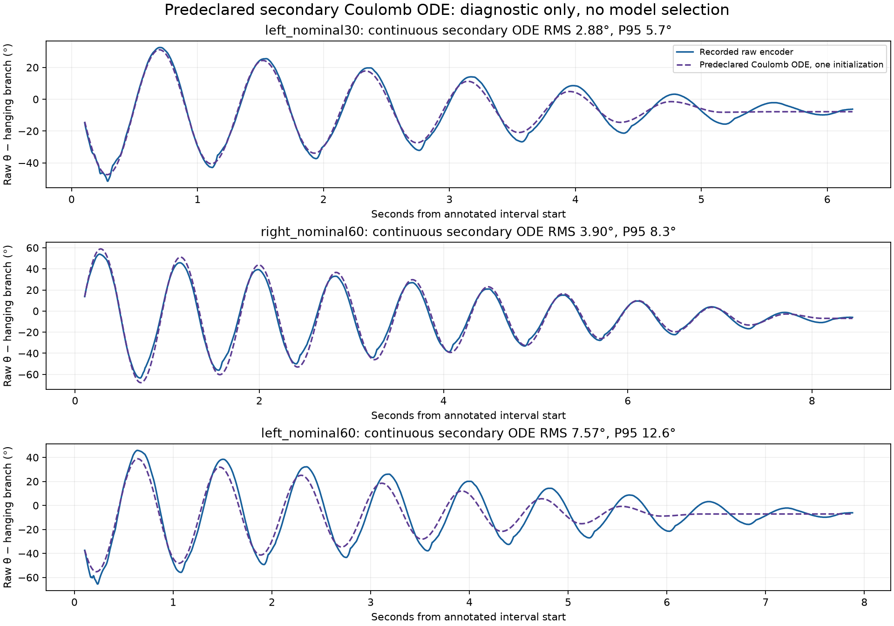
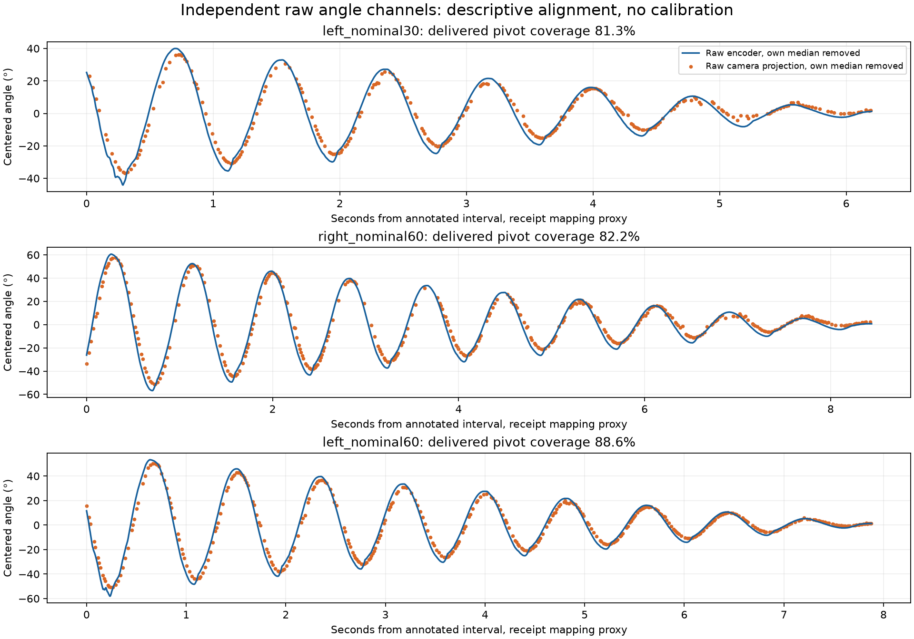

# New manual releases: frozen Oct16 model assessment

The unchanged primary model **fails the aggregate short-forecast gate** on this independent recording. The first two annotated releases pass individually; `left_nominal60` fails. The predeclared nonnegative Coulomb comparison does not improve the aggregate short forecast. No parameters, encoder reference, camera calibration, hardware gains, model defaults, or acceptance gates were changed, and neither candidate is promoted.

`manual-repeatability-01` was newly collected after both candidates existed. The operator held the cart by hand. The parent selected and hashed the three free-release intervals from an unscored 40 ms preview and the operator protocol before model scoring. The complete raw recording, not the preview or compact columns, supplies every scored angle. Requested angle labels are not measured amplitudes. There is only one new release per requested condition, so these results do not estimate statistical repeatability at each condition.

## Admission and frozen quantities

Package `passive_episodes` verified the source-bound annotations, modern completed/STOP-confirmed report, zero dropped records, healthy disabled board states, one session, stable encoder reference 330 and home epoch 15. Three exact duplicate snapshots were removed without dropping distinct measurements. Selected intervals are 74.10–80.30, 85.06–93.50, and 100.82–108.70 seconds from the first raw board timestamp; all selected sample gaps are 4 ms.

Primary coefficients are exactly the Oct16 train02 freeze: effective length 0.16073596568158666 m, damping 0.4631556778357131 /s, and fitted local gravity phase −0.11310915597373176 rad. The phase is a local passive-model coordinate mapping, not an independently measured encoder zero. MuJoCo uses the already-preserved candidate configuration with hinge damping = gamma × 0.75 × pole_mass × effective_length². Full simulator configuration, package source hashes and runtime versions are saved in the assessment.

## Unchanged primary scores

Each 0.5-second forecast reinitializes from past raw samples. Fixed validation limits remain RMS ≤0.08 rad, P95 ≤0.15 rad, weak-form NRMSE ≤0.15, at least 3 forecast windows and angle span ≥0.15 rad. Aggregate and individual-release results are both shown; no aggregate pass can hide an individual failure.

| Release label | Short RMS (rad) | Short P95 (rad) | Integral NRMSE | Fixed gates | Continuous MuJoCo RMS | Continuous P95 |
|---|---:|---:|---:|---|---:|---:|
| left_nominal30 | 0.06602 | 0.14802 | 0.09757 | PASS | 2.926° | 6.476° |
| right_nominal60 | 0.04970 | 0.10812 | 0.10217 | PASS | 3.813° | 6.447° |
| left_nominal60 | 0.10044 | 0.28210 | 0.10227 | FAIL | 7.775° | 13.276° |

Aggregate: 43 forecasts, 5375 forecasted samples, RMS 0.07519781 rad, P95 0.17110644 rad, integral NRMSE 0.10128913. P95 exceeds its unchanged limit.

Continuous MuJoCo is a separate diagnostic, with one initialization per release after a 0.1 s prefix. Initial velocity uses only the preceding 11 samples over 40 ms. The simulator then receives no later measurements. All simulated cart accelerations remain below 1.1e−16 m/s² with no force saturation. Continuous trajectories have no newly invented pass gate. Their better or worse errors cannot be substituted for the predeclared half-second forecast gate.



Plots subtract only an integer-turn hanging branch from raw angles; predictions have the frozen phase restored to the raw coordinate. The horizontal line is the model’s fitted local equilibrium. No measured angle is recentered using a newly fitted phase.

## Predeclared secondary Coulomb ODE

The exact previously trained constrained coefficients [60.70229513666145, 0, 6.858692717887795, 1.6924943487382909] were hash-pinned in a timestamped predeclaration before loading the complete new recording. This candidate was fitted only on Oct16 train02; old heldout results were already development diagnostics. The frozen `passive_fit.advance` supplies its half-second and once-initialized continuous predictions. This is explicitly an ODE comparison, separate from the primary actual MuJoCo simulation.

Secondary aggregate short RMS 0.07726165 rad and P95 0.17477074 rad are slightly worse than primary. Its continuous RMS values are 2.877°, 3.905°, 7.567°. The small mixed continuous differences do not repair the main discrepancy, select this candidate, or establish that every friction model is inadequate.



## Independent camera channel

Only direct raw vision `t`, `image_angle_rad`, and `pivot_px` are used; no SDK fusion, mirrored encoder, old metric calibration or calibrated camera angle enters this diagnostic. The same-host assertion permits a fitted board-snapshot-to-host-receipt clock proxy. Camera `t` is a host read timestamp, not exposure time. OLS receipt residual P95 is 5.52 ms; the maximum discrepancy from a unit-slope median-offset mapping is 18.87 ms over the recording. This is not a calibrated sensor latency or board clock-drift measurement.

| Release label | Valid delivered geometry | Largest valid gap | Pivot radial P95 | Encoder period median | Camera period median | Angle gain | Hanging-branch offset | Angle residual RMS |
|---|---:|---:|---:|---:|---:|---:|---:|---:|
| left_nominal30 | 81.3% | 88.1 ms | 0.398 px | 0.81564 s | 0.82880 s | 1.06572 | -0.12936 rad | 3.698° |
| right_nominal60 | 82.2% | 137.7 ms | 0.390 px | 0.82557 s | 0.83111 s | 1.05314 | -0.12430 rad | 4.733° |
| left_nominal60 | 88.6% | 75.1 ms | 0.451 px | 0.82175 s | 0.82260 s | 1.06229 | -0.12609 rad | 4.069° |

Angle comparison is the per-release descriptive regression `encoder_raw − integer-turn hanging branch = offset + gain × (−image_angle_raw)`, at zero proxy lag. Gain and offset are fitted on the same observations and cannot establish independent angular calibration, sensor linearity or an encoder-reference correction. The camera plot instead removes each channel’s own median for display and applies no fitted gain.

Period estimates use positive-going crossings about each channel’s within-interval median with 0.025 rad hysteresis; interpolation never bridges gaps over 50 ms. Missing crossings remain missing. Camera intervals around 1.64 s in the first release and 1.63–1.71 s in the second are retained multi-cycle intervals, not interpreted as physical period doubling. The third release has eight successive camera periods closely following the encoder. Finite amplitude, damping, sampling, zero choice and missing crossings affect median comparisons.

All three release-specific geometry coverages fall below the historical 90% camera diagnostic threshold; the second also exceeds its 100 ms gap threshold. Fractions count delivered frames, not expected camera exposures. Valid pivot radial P95 is below 0.46 px (maximum below 0.62 px), which supports only image-plane stability of the detected pivot. It cannot certify metric cart stationarity, camera immobility or absence of pose-dependent detector error.

Camera/encoder angle residual is largest for the right release, whereas model/encoder prediction error is largest for the larger left release. Thus these observations do not support a simple claim that the worst model error follows the worst camera detection or angular disagreement. Similar periods and broadly matching shapes are useful corroboration, but do not distinguish friction, initialization, encoder nonlinearity, projection geometry or imperfect hand restraint as the cause.



## Reproduce and audit

Run from the repository root with NumPy, Matplotlib and MuJoCo available (the script also declares uv dependencies). Use a new output directory; existing results are never overwritten.

```sh
uv run --script evidence/system-id-20261017/tools/evaluate_manual_repeatability.py \
  --repo "$PWD" \
  --input evidence/system-id-20261017/raw-manual-repeatability/manual-repeatability-01/rig-1792251521290789944-1148199442.jsonl.gz \
  --annotations evidence/system-id-20261017/analysis/manual-repeatability-annotations.json \
  --annotations-sha256 f2ee8d8c478682c8612adccc211386e6f8aac4a236a03376696c57575189f136 \
  --vision evidence/system-id-20261017/raw-manual-repeatability/manual-repeatability-01/vision.ndjson.gz \
  --same-host-clocks \
  --secondary-predeclaration evidence/system-id-20261017/analysis/manual-repeatability-secondary-predeclaration.json \
  --secondary-predeclaration-sha256 d5543eb6e44714627e9395d3684ed05ee4d220d44d93c5e81ce64bd44b613519 \
  --output /tmp/manual-repeatability-replay
```

Focused synthetic tests prohibit refitting, verify static validation rejection, causal continuous initialization for both solvers, source/annotation pin rejection, camera edge-gap accounting, crossing gaps, and integer-turn display invariance. Related camera and pulse batch tests are also run. See `verification.json` for exact command, counts, source hashes and numerical replay invariance.

| Artifact | SHA256 |
|---|---|
| Complete decompressed raw recording | `63edec18d9665fc362bef3546c05b7d74b44bf27605af87ab4002c7b3bffcb39` |
| Complete decompressed raw camera | `f46295c5fa213c029d53cac9557cfa9ce0b37bc2acdfc53a46758ffdd43b701e` |
| Bound completion report | `6c68586670c3e3037a2cbd4e0217e1fbce76bb46689c44274ff4e551175b97cd` |
| Frozen annotations | `f2ee8d8c478682c8612adccc211386e6f8aac4a236a03376696c57575189f136` |
| Primary training freeze | `04befe14b16a54e5288d4326a7ca5d826e8c5a169dc20206dd1108ea160aa744` |
| Primary model config | `cc878a16d1611f8f03534a44611f9172c0eab2d2c968a6ce1f0c351b5880c7e0` |
| Secondary source | `3554020434d19735c09514a70cecb878cd92d7af8e9b7743167ab84ff098b530` |
| Evaluator | `c85462fec229bfe00b953c7c3493414b94f2729f2ace74e507fad3ea31332546` |
| Assessment | `2a803bd6e0555d7a1714f99571ec6fa33bd85ffbf23d6d2a819c034267b2ecc7` |

No forced-input, upright, full-rig or reinforcement-learning validity follows from this passive comparison. Further tuning would make this recording development data; another independent test would be required for subsequent acceptance.
