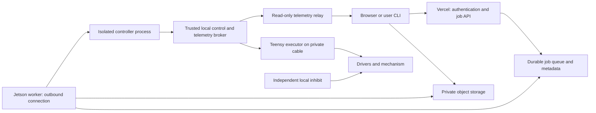

# Internet jobs and sensorshare

This is the proposed next architecture. The deployment starter implements the
local firmware/SDK/simulation/characterization pieces, not these cloud services,
an untrusted-code runner, an ONNX loader or a remote broker.

## Start with two products

First publish read-only telemetry. Then add scheduled, exclusive local experiments
with owner-approved controllers. Only after the safety boundary and isolation are
tested should you accept arbitrary public Python or model artifacts. A good
sensor-streaming product does not need arbitrary code execution to be useful.



Only the broker can reach the Teensy. A policy gets observations and a narrowly
scoped action interface. The broker admits one experiment, applies owner limits,
translates its fresh outputs to D1 actions and stops on missing/invalid output.
It must not keep renewing the last action after a policy stalls. The Teensy is
the final software deadline and command-limit authority.

The public network is outside the stabilizing control loop. Policies execute on
the Jetson, while pulse generation and the 1 kHz governor remain on the Teensy.
Benchmark the synchronous SDK on the actual Jetson before choosing a policy rate;
start around 100 Hz. Its fresh-state request plus action acknowledgement adds
round trips. The configured 500 Hz telemetry maximum is not a measured 500 Hz
closed-loop guarantee. A later broker can pipeline timestamped observations and
actions without weakening expiry semantics. If the policy needs tighter deadlines
than the measured path permits, move a bounded controller into the trusted MCU
or use a dedicated controller separated from the independent safety hardware.

## Uploads through Vercel

Use Vercel for the web app, authentication, authorization and job metadata. Let
the browser upload directly to private object storage using a narrowly scoped,
short-lived upload token. Vercel documents authenticated server-mediated tokens
and direct [Blob client uploads](https://vercel.com/docs/vercel-blob/client-upload).
Do not forward a large artifact through the Jetson's public address.

An artifact manifest should identify the owner, immutable storage object, SHA-256,
size, format, entry point, SDK version, dependency/runtime version, observation and
action contract, requested policy frequency and maximum run duration. Hashes verify
artifact identity; they do not make code trustworthy. Authorize both submission
and execution separately, and verify the hash again on the Jetson.

Suggested flow:

1. Authenticate user, check quota, issue upload token and create an upload record.
2. Store immutable artifact and validate manifest/size/type without executing it.
3. Queue the job after authorization; the Jetson claims a lease using an outbound
   connection. Tie the local broker's exclusive admission to a job ID and fresh
   lease generation so an old worker cannot resume an already reassigned job.
4. Validate in isolation, run simulation checks, then run a bounded physical job
   only when the local rig is commissioned and made ready by its owner.
5. Publish logs, samples, artifact/config hashes and outcome. Cancellation revokes
   control and stops locally. A cloud reconnect must not silently rerun a job.

Keep durable states such as `uploaded`, `validated`, `queued`, `leased`, `running`,
`succeeded`, `failed`, `cancelled`; distinguish an upload from a completed run.
The local broker should have its own run deadline and react to authorization lease
loss. Cloud outages must not leave an indefinite job running.

## Controller contract and isolation

Begin with fixed-runtime Python `reset(context)` / `step(observation) -> action`
controllers, and ONNX models with declared tensor names, shapes, dtype, units,
normalization, action scaling and optional recurrent state. Reject nonfinite or
incorrectly shaped outputs. ONNX is a model artifact, not a complete controller:
sampling, feature transforms, state handling and output mapping still matter.

Do not accept raw Teensy firmware from untrusted users on the chip that owns the
safety checks. Arbitrary firmware can bypass those checks. Firmware experiments
require a separate, owner-controlled safety system with independent sensors and
authority over the driver's physical enable/power path.

For the first physical releases, accept owner-reviewed controllers. Before public
Python execution, provide a separate unprivileged process/runtime with explicit
CPU/memory/time/process/output limits, read-only runtime, disposable work directory,
no secrets, no raw network/device access and only the narrow local broker channel.
Do not give it the host network, Docker socket, USB device or firmware port. Model
parsing also runs in isolation with resource caps. Validate the chosen isolation
on the actual Jetson OS/architecture; an ordinary container alone is not a complete
hostile-code boundary. GPU access increases the host attack surface and complicates
resource isolation. Keep it opt-in until that boundary is tested.

## Sensorshare

`sensorshare encoder --device pendulum --hz 100` is a useful first user experience.
The CLI runs on a subscriber's computer. The Jetson hosts the acquisition service
and optionally a read-only endpoint, or publishes outbound to a relay. Your CLI
can target that relay using a read-scoped token without opening the control port.

The current hardware has an AS5600 angle encoder and derived angular velocity.
No IMU driver was found in the source. Advertise `encoder` and `state`; return an
explicit unsupported capability for `imu`. When a real IMU is connected, publish
its acceleration/gyro values, units, sensor frame and calibration independently.
Never label angular encoder estimates as IMU measurements.

Run a single acquisition/control broker owning the Teensy socket. It timestamps
and copies state to a fan-out path. Give each subscriber a bounded queue, a rate
limit and explicit sequence/gap metadata; drop old samples for a slow live reader
instead of delaying control. Full archival logging is a separate bounded path.
Do not let a user's stream request reconfigure the encoder or motor control rate.

Suggested message envelope (the values below are an illustrative schema):

```json
{
  "schema_version": 1,
  "device_id": "pendulum",
  "boot_id": "broker-observed-device-epoch",
  "sample_sequence": 42,
  "device_time_us": 1250000,
  "host_received_monotonic_ns": 987654321000,
  "sensor": "encoder",
  "calibration_id": "owner-recorded-reference",
  "values": {"theta_rad": 0.12, "omega_rad_s": -0.4, "encoder_raw": 31},
  "valid": true,
  "dropped_since_last": 0
}
```

Publish the coordinate convention (`theta=0` upright, positive top toward +x),
actual negotiated rate, filtering and timebase separately in stream metadata.
Device microseconds wrap after roughly 71.6 minutes; unwrap within a boot epoch,
and distinguish reconnects from resets. Host monotonic time is meaningful only
within its host boot; add wall-clock mapping and uncertainty when comparing devices.
The public sample sequence is distinct from the current D1 action sequence.

Separate `read:sensors` permission from `run:experiment`. Read-only subscribers
must never arm, home, reset, calibrate or stop another experiment. The current
`HardwareRig` is a trusted local operator SDK and has those methods; **do not expose
it as the public client object**. Build a separate remote read-only client.

Vercel Functions currently offer [WebSockets in beta](https://vercel.com/docs/functions/websockets).
Connections have a function-duration limit, reconnects can reach another instance,
and cross-instance state/pub-sub needs an external store. Thus a Vercel relay is
possible, but budget for reconnect/resubscribe and bounded buffering. A small
persistent relay service is also a straightforward choice for long-lived sensor
streams. Neither choice should influence motor command deadlines.

The first useful milestone is authenticated read-only encoder streaming with
several simultaneous subscribers, visible sample gaps and stable control timing.
The next is queued owner-approved simulation jobs, then supervised physical jobs.
